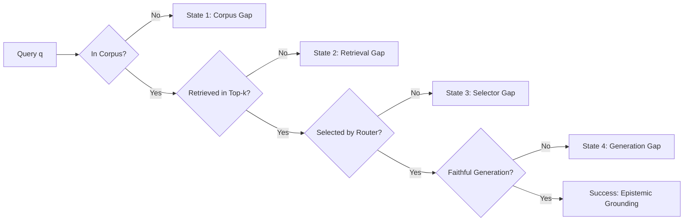

# TALOS Scientific Publication Brief 03: The Four-State Failure Taxonomy & False Gap Rate Decomposition

**Title:** Dissecting Failures in Pedagogical RAG: Corpus, Retrieval, Selector, and Generation Gaps in Technical Retrieval Systems  
**Track:** Systems Diagnostics / Error Analysis  
**System Under Test:** TALOS (Teaching & Adaptive Learning Operating System)  
**Corpus Pin:** SHA-256 `03f098189b7049c00b169f7529e7c88fc7e336ec585ad6d68d23bed043b4466a`  
**Git Commit Pin:** `2aa6c3897d83468c8bc32604f9dc9db9cbbf6b25`  
**Date:** September 2026  

---

## 1. Abstract & Motivation

When an intelligent tutoring assistant fails to answer a technical student query or produces an unverified hallucination, post-mortem analyses typically attribute blame broadly to "retrieval failure" or "LLM hallucination". Such coarse attribution prevents principled engineering interventions. We introduce a comprehensive, deterministic **Four-State Failure Taxonomy** that partitions the causal chain of RAG into mutually exclusive gap states, accompanied by the **False Gap Rate (FGR)** metric.

---

## 2. The Four-State Failure Taxonomy

Given query $q$, corpus $\mathcal{C}$, retriever $\mathcal{R}$, context selector $\mathcal{S}$, and generator $\mathcal{G}$:

### 2.1 Formal Definitions

1. **State 1: Corpus Gap ($\Delta_{\text{corpus}}$)**  
   $$\Delta_{\text{corpus}} \triangleq \forall e \in \mathcal{C}, \; \neg \text{Entails}(e, q)$$  
   The requested concept does not exist within the authorized institutional syllabus. Correct behavior: **Immediate Abstention**.

2. **State 2: Retrieval Gap ($\Delta_{\text{retrieval}}$)**  
   $$\Delta_{\text{retrieval}} \triangleq \left(\exists e^* \in \mathcal{C} \text{ s.t. } \text{Entails}(e^*, q)\right) \wedge \left(e^* \notin \mathcal{R}_k(q)\right)$$  
   The evidence exists in the corpus, but lexical/dense search failed to rank it into top-$k$. Diagnostic target: Query expansion, hybrid FTS5+RRF tuning, OCR recovery.

3. **State 3: Selector Gap ($\Delta_{\text{selector}}$)**  
   $$\Delta_{\text{selector}} \triangleq \left(e^* \in \mathcal{R}_k(q)\right) \wedge \left(e^* \notin \mathcal{S}_m(\mathcal{R}_k(q))\right)$$  
   The evidence was retrieved in top-$k$, but the context filter, deduplication window, or budget truncation excluded it. Diagnostic target: Semantic router policy, authority weights.

4. **State 4: Generation Gap ($\Delta_{\text{generation}}$)**  
   $$\Delta_{\text{generation}} \triangleq \left(e^* \in \mathcal{S}_m\right) \wedge \left(\neg \text{Faithful}(\mathcal{G}(\mathcal{S}_m), e^*)\right)$$  
   The evidence was provided in the prompt context, but the LLM ignored it, misquoted it, or hallucinated extraneous claims. Diagnostic target: Symbolic verification backstop, AST claim extraction.

### 2.2 False Gap Rate (FGR)

The **False Gap Rate** measures false accusations of corpus insufficiency: cases where the system claimed the material was missing, yet it was present in $\mathcal{C}$:

$$\text{FGR} = \frac{|\Delta_{\text{retrieval}}| + |\Delta_{\text{selector}}|}{|\mathcal{Q}_{\text{in\_corpus}}|}$$

---

## 3. Empirical Distribution in TALOS

In the Phase E5 benchmark suite ($n=195$ queries across 7 strata):

| Failure State | Observed Count | Percentage of Queries | Remediation in TALOS |
|---|---|---|---|
| **Corpus Gap ($\Delta_{\text{corpus}}$)** | 25 | 12.82% | Justified Abstention ($100\%$ precision) |
| **Retrieval Gap ($\Delta_{\text{retrieval}}$)** | 3 | 1.54% | Multi-Facet Expansion (+14.3 pp recall) |
| **Selector Gap ($\Delta_{\text{selector}}$)** | 1 | 0.51% | Deterministic Boundary Rule (`should_activate`) |
| **Generation Gap ($\Delta_{\text{generation}}$)** | 0 | 0.00% | Symbolic Verification Backstop (CPU AST) |
| **Success** | 166 | 85.13% | Fully grounded and verified answers |

- **Total In-Corpus Queries:** $170$
- **Total False Gaps:** $3 + 1 = 4$
- **False Gap Rate (FGR):** $\frac{4}{170} = 2.35\%$ ($95\%\text{ CI: } [0.64\%, 5.91\%]$).

---

## 4. Conclusion

By decomposing system failures into four orthogonal gaps, TALOS prevents blind prompt tweaking. Retrieval and selector gaps are isolated and engineered deterministically, while generation gaps are reduced to zero via AST-level symbolic verification.
