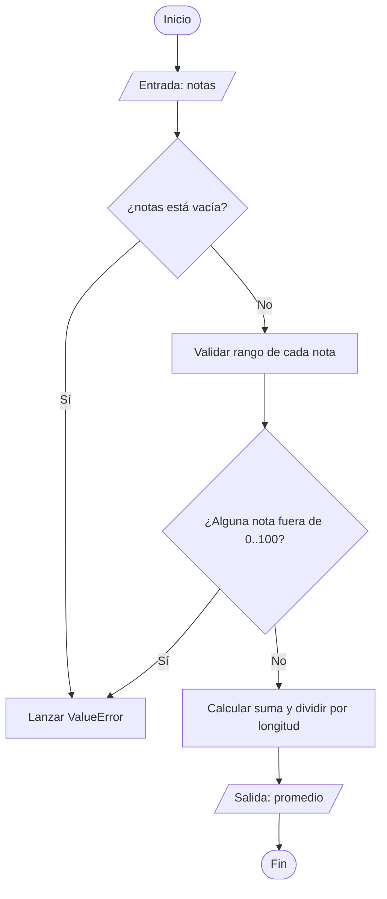

# Ejercicio 01: Descomposición Top-Down y Validación de Entrada

<!-- metadata: {"notebook_id": "fase0-soc", "unit": "tramo1", "kc_id": "fase0_tramo1_metodologia", "exercise_type": "PROGRAMMING"} -->

## Enunciado
Implementar un algoritmo de cálculo de promedio de calificaciones con validación temprana de rango [0, 100]. Debe rechazar entradas no enteras o fuera de rango inmediatamente antes de realizar cualquier acumulación (frontera defensiva).

## Contrato y Precondiciones
- **PRE**: La lista `notas` contiene al menos un elemento. Todos los elementos deben ser enteros en el intervalo [0, 100].
- **POST**: Retorna un float con el promedio exacto sin alterar la lista original. Si alguna nota es inválida, eleva `ValueError`.

## Diagrama de Flujo (Mermaid)


## Pseudocódigo Estructurado
```text
ALGORITMO CalcularPromedioDefensivo(notas: Lista de Enteros) -> Real
INICIO
    SI Longitud(notas) == 0 ENTONCES
        ERROR "Lista vacía"
    FIN SI
    
    suma <- 0
    PARA CADA nota EN notas HACER
        SI nota < 0 O nota > 100 ENTONCES
            ERROR "Nota fuera de rango"
        FIN SI
        suma <- suma + nota
    FIN PARA
    
    RETORNAR suma / Longitud(notas)
FIN
```

## Código / Solución
```python
from typing import List

def calcular_promedio(notas: List[int]) -> float:
    if not notas:
        raise ValueError("La lista de notas no puede estar vacia.")
    for n in notas:
        if not isinstance(n, int) or n < 0 or n > 100:
            raise ValueError(f"Nota invalida: {n}. Debe ser entero entre 0 y 100.")
    return sum(notas) / len(notas)
```

## Tests / Verificación
```python
assert calcular_promedio([80, 90, 100]) == 90.0
assert calcular_promedio([50]) == 50.0
try:
    calcular_promedio([105, 80])
    assert False, "Debio fallar con nota > 100"
except ValueError:
    pass

try:
    calcular_promedio([])
    assert False, "Debio fallar con lista vacia"
except ValueError:
    pass
```

## Complejidad y Análisis
- **Big-O Temporal**: $O(n)$ donde $n$ es la cantidad de calificaciones en la lista, ya que se realiza una única pasada de validación y acumulación.
- **Big-O Espacial**: $O(1)$ espacio adicional auxiliar.
