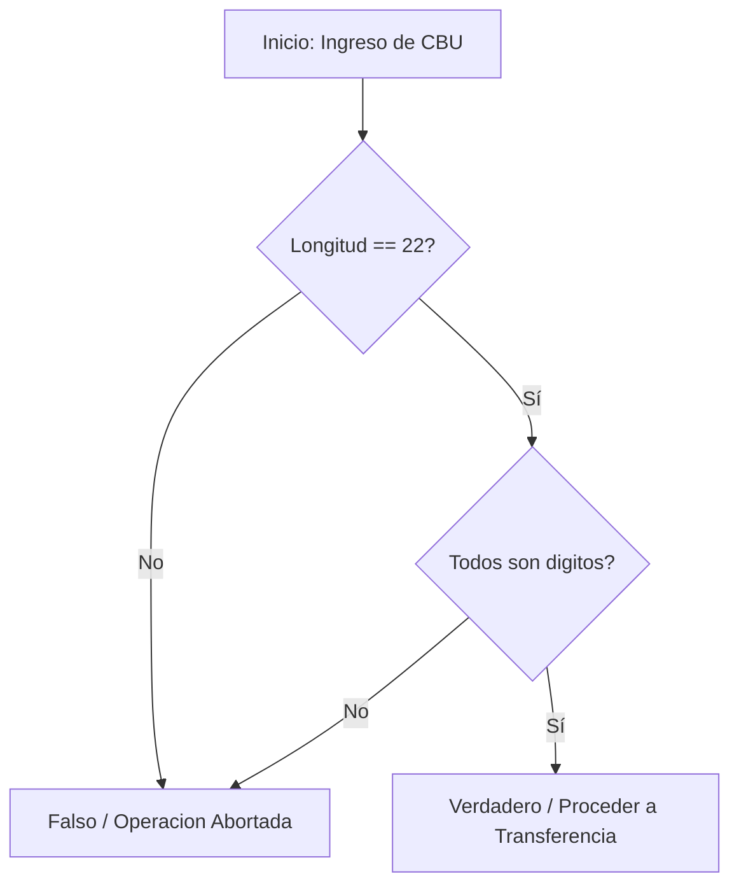

# Ejercicio 01: Validador Defensivo de CBU Bancario (Top-Down)

<!-- metadata: {"notebook_id": "fase0-soc", "unit": "tramo1", "kc_id": "fase0_tramo1_metodologia", "exercise_type": "PROGRAMMING"} -->

## Enunciado
Implementar un algoritmo de validación de CBU (Clave Bancaria Uniforme) de 22 caracteres numéricos. Debe descomponerse en módulos y aplicar frontera defensiva temprana rechazando cadenas con longitud diferente a 22 o caracteres no numéricos.

## Contrato Formal
```
PRE: cbu es una cadena de texto (str)
POST: retorna True si cbu tiene exactamente 22 caracteres y todos son digitos, False en caso contrario
```

## Diagrama de Flujo


## Pseudocódigo
```text
// Problema B "CBU"
// Entrada: cbu_usuario
// Salida: Valido o Invalido
// Restricciones: entrada debe ser exactamente 22 caracteres

Algoritmo ValidadorCBU Es
    Var
        cadena: cbu_usuario
    Inicio
        cbu_usuario = ""
        llamar_a Resultado(cbu_usuario)
Fin

procedimiento ValidadorCBU(E cadena: cbu)
    Inicio
        si longitud(cbu) == 22 Entonces
            Escribir("CBU VÁLIDO. PROCEDIENDO A TRANSFERENCIA")
        Sino
            Escribir("CBU INVÁLIDO. OPERACIÓN ABORTADA")
        fin_si
Fin_procedimiento
```

## Código Python
```python
def validar_cbu(cbu: str) -> bool:
    """Validación defensiva de CBU bancario (22 caracteres numéricos)."""
    if not isinstance(cbu, str):
        return False
    if len(cbu) != 22:
        return False
    return cbu.isdigit()
```

## Casos de Prueba
```python
assert validar_cbu("0170099320000067543210") is True
assert validar_cbu("123") is False
assert validar_cbu("017009932000006754321A") is False
assert validar_cbu("01700993200000675432100") is False
assert validar_cbu("") is False
```

## Análisis de Complejidad
- Complejidad Temporal: O(n) donde n=22 caracteres (tiempo constante acotado O(1)).
- Complejidad Espacial: O(1) memoria auxiliar.
