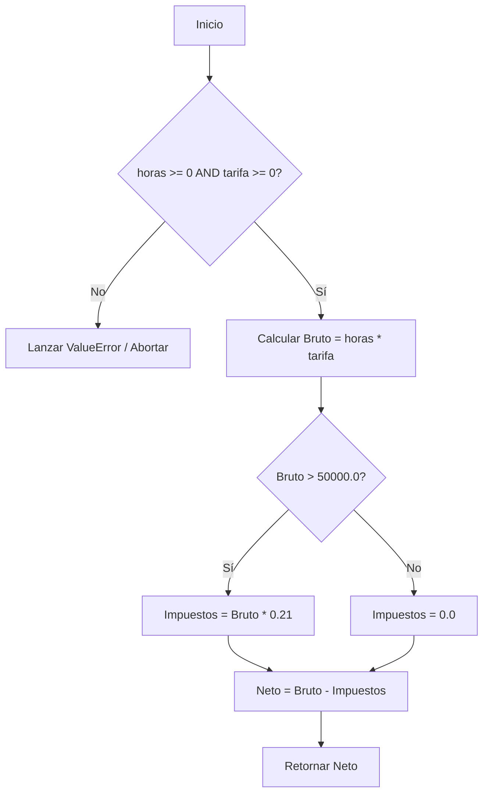

# Ejercicio 02: Cálculo de Sueldo Neto y Frontera Defensiva

<!-- metadata: {"notebook_id": "fase0-soc", "unit": "tramo1", "kc_id": "fase0_tramo1_metodologia", "exercise_type": "PROGRAMMING"} -->

## Enunciado
Calcular el sueldo neto aplicando deducción impositiva del 21% sobre el excedente del mínimo no imponible ($50.000). Debe validar en la frontera que ni las horas ni la tarifa sean negativas.

## Contrato Formal
```
PRE: horas_trabajadas >= 0.0 y tarifa_horaria >= 0.0
POST: retorna sueldo neto deducido de alicuota impositiva (21%) si supera minimo no imponible
```

## Diagrama de Flujo


## Pseudocódigo
```text
Algoritmo CalculoSueldoSeguro
const
    real: ALICUOTA_IMPUESTO = 0.21
    real: MINIMO_NO_IMPONIBLE = 50000.0
var
    real: horas_trabajadas, tarifa_horaria
inicio
    horas_trabajadas = 0.0
    tarifa_horaria = 0.0
    escribir("Ingrese las horas trabajadas:")
    leer(horas_trabajadas)
    escribir("Ingrese la tarifa por hora:")
    leer(tarifa_horaria)
    llamar_a Resultados(horas_trabajadas, tarifa_horaria)
Fin
```

## Código Python
```python
def calcular_sueldo_neto(horas_trabajadas: float, tarifa_horaria: float) -> float:
    """Cálculo de sueldo neto con frontera defensiva contra valores negativos."""
    if horas_trabajadas < 0.0 or tarifa_horaria < 0.0:
        raise ValueError("Horas y tarifa deben ser valores no negativos")
    sueldo_bruto = horas_trabajadas * tarifa_horaria
    minimo_no_imponible = 50000.0
    alicuota = 0.21
    impuestos = sueldo_bruto * alicuota if sueldo_bruto > minimo_no_imponible else 0.0
    return sueldo_bruto - impuestos
```

## Casos de Prueba
```python
assert calcular_sueldo_neto(100.0, 400.0) == 40000.0
assert calcular_sueldo_neto(100.0, 1000.0) == 79000.0
try:
    calcular_sueldo_neto(-5.0, 100.0)
    assert False, "Debio fallar con horas negativas"
except ValueError:
    pass
```

## Análisis de Complejidad
- Complejidad Temporal: O(1) operaciones aritméticas directas.
- Complejidad Espacial: O(1) variables de acumulación.
