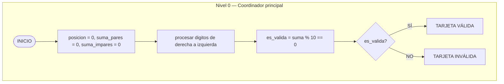

# Ejercicio 01: Motor de Cálculo y Validador de Tarjetas (Algoritmo de Luhn)

<!-- metadata: {"notebook_id": "fase0-soc", "unit": "tramo2", "kc_id": "fase0_tramo2_logica_control", "exercise_type": "PROGRAMMING"} -->

## Enunciado
Implementar el algoritmo de Luhn (ISO/IEC 7812) para la verificación de integridad de números de tarjetas de crédito. Requiere duplicar dígitos alternados, ajustar sumas mayores a 9 (-9) y validar que el total acumulado sea divisible por 10.

## Contrato Formal
```
PRE: numero_tarjeta es una cadena de digitos numericos de longitud >= 2
POST: retorna True si la suma de Luhn modular 10 es cero, False en caso contrario
```

## Diagrama de Flujo


## Pseudocódigo
```text
algoritmo TarjetaValidaEs
var
    cadena: tarjeta_caracter
    entero: posicion, suma_si_impar, suma_si_par
    booleano: es_valida
Inicio
    // Nivel 0 llama a Nivel 1 pasando referencias fisicas de la RAM
    llamar_a procesador_entradas(tarjeta_caracter, posicion, suma_si_impar, suma_si_par)
    es_valida = validar(posicion, suma_si_impar, suma_si_par)
fin

procedimiento multiplicador(E entero: digito) -> entero
var
    entero: doble
Inicio
    doble = digito * 2
    si doble > 9 entonces
        devolver doble - 9
    si_no
        devolver doble
    fin_si
fin_procedimiento
```

## Código Python
```python
def multiplicador(digito: int) -> int:
    """Motor de cálculo de Luhn para duplicación de dígito individual."""
    doble = digito * 2
    if doble > 9:
        return doble - 9
    return doble


def validar_tarjeta_luhn(numero_tarjeta: str) -> bool:
    """Validador de tarjeta de crédito mediante algoritmo de Luhn."""
    if not isinstance(numero_tarjeta, str) or not numero_tarjeta.isdigit() or len(numero_tarjeta) < 2:
        return False
    reverso = numero_tarjeta[::-1]
    suma = 0
    for idx, char in enumerate(reverso):
        digito = int(char)
        if idx % 2 == 1:
            suma += multiplicador(digito)
        else:
            suma += digito
    return suma % 10 == 0
```

## Casos de Prueba
```python
assert multiplicador(4) == 8
assert multiplicador(7) == 5
assert validar_tarjeta_luhn("49927398716") is True
assert validar_tarjeta_luhn("49927398717") is False
assert validar_tarjeta_luhn("") is False
assert validar_tarjeta_luhn("123") is False
```

## Análisis de Complejidad
- Complejidad Temporal: O(n) donde n es la longitud del número de tarjeta.
- Complejidad Espacial: O(n) para la cadena invertida.
