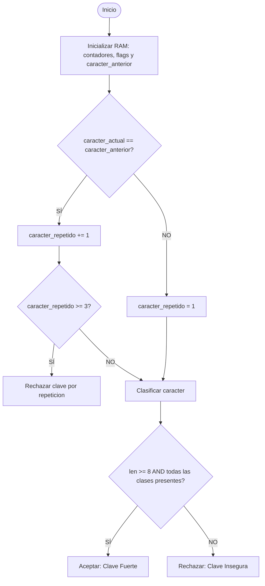

# Ejercicio 01: Validador Modular de Contraseñas Seguras y Control de Repetición

<!-- metadata: {"notebook_id": "fase0-soc", "unit": "tramo3", "kc_id": "fase0_tramo3_modularidad_memoria", "exercise_type": "PROGRAMMING"} -->

## Enunciado
Implementar un validador de contraseñas seguras bajo política de ciberdefensa: longitud mínima de 8 caracteres, al menos una mayúscula, una minúscula, un número y un caracter especial. Debe rechazar claves con secuencias de más de 2 caracteres idénticos consecutivos.

## Contrato Formal
```
PRE: clave es una cadena de texto (str)
POST: retorna True si la clave cumple longitud >= 8, cuatro clases de caracteres y no repite 3 caracteres consecutivos
```

## Diagrama de Flujo


## Pseudocódigo
```text
Algoritmo ContrasenaSegura
Var
    cadena: clave
    booleano: valida
Inicio
    // Coordinador de verificacion de integridad en RAM
    valida = Coordinador(clave)
    si valida entonces
        Escribir("CONTRASENA FUERTE")
    si_no
        Escribir("CONTRASENA RECHAZADA")
    fin_si
Fin
```

## Código Python
```python
def validar_contrasena_segura(clave: str) -> bool:
    """Validador modular de contrasena fuerte con politica estricta y sin repeticion multiple."""
    if not isinstance(clave, str) or len(clave) < 8:
        return False
    tiene_mayus = False
    tiene_minus = False
    tiene_num = False
    tiene_esp = False
    caracter_repetido = 1
    caracter_anterior = ""
    for c in clave:
        if c == caracter_anterior:
            caracter_repetido += 1
            if caracter_repetido >= 3:
                return False
        else:
            caracter_repetido = 1
        caracter_anterior = c

        if "A" <= c <= "Z":
            tiene_mayus = True
        elif "a" <= c <= "z":
            tiene_minus = True
        elif "0" <= c <= "9":
            tiene_num = True
        else:
            tiene_esp = True

    return tiene_mayus and tiene_minus and tiene_num and tiene_esp
```

## Casos de Prueba
```python
assert validar_contrasena_segura("Admin123!") is True
assert validar_contrasena_segura("C0ntr@Seña") is True
assert validar_contrasena_segura("aaaB1!cd") is False
assert validar_contrasena_segura("corta1!") is False
assert validar_contrasena_segura("Sololetrasypunto.") is False
assert validar_contrasena_segura("1234567890!") is False
```

## Análisis de Complejidad
- Complejidad Temporal: O(n) un solo recorrido lineal de la cadena.
- Complejidad Espacial: O(1) uso estricto de banderas booleanas en Stack Frame.
