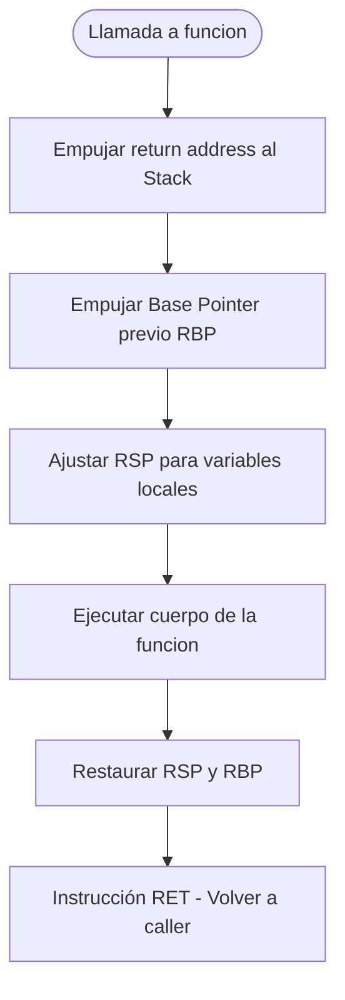

# Ejercicio 01: Simulación y Trazado de Stack Frame

<!-- metadata: {"notebook_id": "fase0-soc", "unit": "tramo3", "kc_id": "fase0_tramo3_modularidad_memoria", "exercise_type": "PROGRAMMING"} -->

## Enunciado
Implementar un simulador de llamadas y activación de Stack Frame para subrutinas, calculando la profundidad máxima de pila y detectando desbordamientos de pila (Stack Overflow) simulados.

## Contrato y Precondiciones
- **PRE**: `max_stack_depth` entero positivo. `call_tree` tupla o estructura recursiva de funciones.
- **POST**: Retorna la lista ordenada de marcos de pila (Stack Frames) creados y destruidos con sus direcciones virtuales relativas.

## Diagrama de Flujo (Mermaid)


## Pseudocódigo Estructurado
```text
CLASE StackFrame
    nombre: Cadena
    rbp: Entero
    rsp: Entero
    parametros: Lista

ALGORITMO EjecutarSubrutina(nombre: Cadena, profundidad: Entero, max_prof: Entero)
INICIO
    SI profundidad >= max_prof ENTONCES
        ERROR "Stack Overflow detectado"
    FIN SI
    frame <- NUEVO StackFrame(nombre, profundidad)
    // Procesar llamada
    RETORNAR frame
FIN
```

## Código / Solución
```python
from typing import List, Dict, Any

class StackSimulation:
    def __init__(self, max_depth: int = 10) -> None:
        self.max_depth = max_depth
        self.stack: List[Dict[str, Any]] = []
        self.history: List[str] = []

    def call(self, func_name: str, args: List[Any]) -> int:
        if len(self.stack) >= self.max_depth:
            raise RecursionError(f"Stack Overflow simulado al invocar {func_name}")
        frame = {
            "func": func_name,
            "args": args,
            "frame_id": len(self.stack),
            "ret_addr": f"0x7FFE{len(self.stack)*16:04X}",
        }
        self.stack.append(frame)
        self.history.append(f"PUSH {func_name} ({frame['ret_addr']})")
        return len(self.stack)

    def ret(self) -> Dict[str, Any]:
        if not self.stack:
            raise IndexError("Stack underflow: no hay frames activos")
        frame = self.stack.pop()
        self.history.append(f"POP {frame['func']}")
        return frame
```

## Tests / Verificación
```python
sim = StackSimulation(max_depth=3)
d1 = sim.call("main", [])
assert d1 == 1
d2 = sim.call("calcular", [10, 20])
assert d2 == 2
d3 = sim.call("helper", [10])
assert d3 == 3

# Intentar sobrepasar límite de pila
try:
    sim.call("overflow_func", [])
    assert False, "Debio fallar con RecursionError"
except RecursionError:
    pass

top = sim.ret()
assert top["func"] == "helper"
assert len(sim.stack) == 2
```

## Complejidad y Análisis
- **Big-O Temporal**: $O(1)$ amortizado por cada operación de PUSH/POP de frame.
- **Big-O Espacial**: $O(d)$ donde $d$ es la profundidad máxima de pila.
