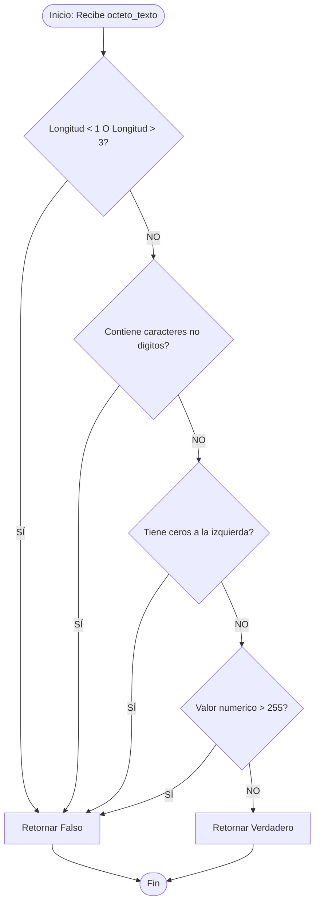

# Ejercicio 01: Descomposición de IPv4 y Validación de Octetos (Aduanas de Control)

<!-- metadata: {"notebook_id": "fase0-soc", "unit": "tramo4", "kc_id": "fase0_tramo4_estructuras_lineales", "exercise_type": "PROGRAMMING"} -->

## Enunciado
Implementar un descomponeador y validador completo de direcciones IPv4. Descompone la cadena delimitada por puntos y pasa cada fragmento por 4 aduanas de control: longitud [1, 3], tipo digito, sin ceros a la izquierda (excepto "0" solo) y rango numérico [0, 255].

## Contrato Formal
```
PRE: ip_recibida es una cadena de texto (str)
POST: retorna True si contiene exactamente 4 octetos que superan las 4 aduanas de control, False en caso contrario
```

## Diagrama de Flujo


## Pseudocódigo
```text
// Problema: descomponer una estrucutra de ipv4
// Entrada: cadena str
// Salida: verdadero o falso
// Restricciones:
//   1: longitud maxima 1 a 3 inclusive
//   2: caracteres en rango '0' a '9'
//   3: ceros a la izquierda prohibidos ("01", "021")
//   4: valores en rango [0..255]

algoritmo DescomponedorIPv4 es
var
    cadena: ip_recibida
    booleano: resultado
Inicio
    resultado = analizar_ip(ip_recibida)
fin

funcion analizar_ip(E cadena: ip_recibida) -> booleano
    // Recorrido secuencial separando por puntos y evaluando es_octeto_valido
fin_funcion
```

## Código Python
```python
def longitud_valida(pedazo: str) -> bool:
    """Valida que el fragmento tenga longitud entre 1 y 3 caracteres."""
    return 1 <= len(pedazo) <= 3


def tipo_valido(pedazo: str) -> bool:
    """Verifica que todos los caracteres sean dígitos numéricos."""
    for c in pedazo:
        if c < "0" or c > "9":
            return False
    return True


def ceros_izq(pedazo: str) -> bool:
    """Prohíbe ceros a la izquierda salvo el '0' aislado."""
    if len(pedazo) != 1 and pedazo[0] == "0":
        return False
    return True


def dentro_rango(pedazo: str) -> bool:
    """Valida que el valor numérico esté en el intervalo [0, 255]."""
    valor = int(pedazo)
    return 0 <= valor <= 255


def es_octeto_valido(pedazo: str) -> bool:
    """Aduana integrada para la validación de un octeto IPv4."""
    return (
        longitud_valida(pedazo)
        and tipo_valido(pedazo)
        and ceros_izq(pedazo)
        and dentro_rango(pedazo)
    )


def analizar_ip(ip_recibida: str) -> bool:
    """Descompone y valida una dirección IPv4 completa en sus 4 octetos."""
    if not isinstance(ip_recibida, str):
        return False
    pedazo = ""
    contador = 0
    for caracter in ip_recibida:
        if caracter != ".":
            pedazo += caracter
        else:
            if not es_octeto_valido(pedazo):
                return False
            contador += 1
            pedazo = ""
    if not es_octeto_valido(pedazo):
        return False
    contador += 1
    return contador == 4
```

## Casos de Prueba
```python
assert analizar_ip("192.168.1.1") is True
assert analizar_ip("255.255.255.255") is True
assert analizar_ip("0.0.0.0") is True
assert analizar_ip("256.1.1.1") is False
assert analizar_ip("01.1.1.1") is False
assert analizar_ip("192.168.1") is False
assert analizar_ip("192.168.1.1.1") is False
assert analizar_ip("192.168.1.a") is False
```

## Análisis de Complejidad
- Complejidad Temporal: O(n) un recorrido lineal estricto de la cadena IP.
- Complejidad Espacial: O(1) memoria acotada al búfer del octeto.
