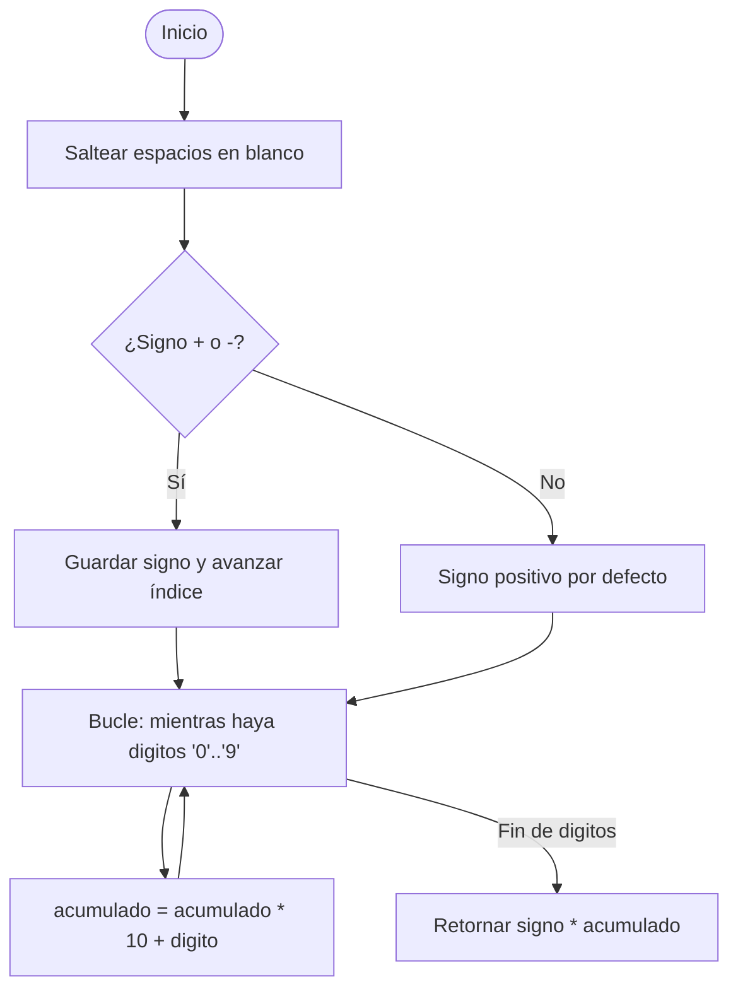

# Ejercicio 01: Parsing Manual de Cadenas sin Librerías Externas

<!-- metadata: {"notebook_id": "fase0-soc", "unit": "tramo4", "kc_id": "fase0_tramo4_estructuras_lineales", "exercise_type": "PROGRAMMING"} -->

## Enunciado
Implementar un parser numérico manual que convierta una cadena de texto representando un entero con signo (equivalente a `atoi`) a un entero nativo, iterando carácter por carácter sobre el arreglo de memoria, validando caracteres válidos y desbordamientos.

## Contrato y Precondiciones
- **PRE**: Cadena `s` contiene caracteres ASCII legibles. Puede incluir espacios iniciales y signo opcional `+` o `-`.
- **POST**: Retorna el valor entero exacto. Si encuentra un carácter inválido no numérico, retorna el acumulado previo o lanza error si la cadena no contenía dígitos válidos.

## Diagrama de Flujo (Mermaid)


## Pseudocódigo Estructurado
```text
ALGORITMO StringToIntManual(cadena: Cadena) -> Entero
INICIO
    i <- 0
    signo <- 1
    acumulado <- 0
    
    MIENTRAS i < Longitud(cadena) Y cadena[i] == ' ' HACER
        i <- i + 1
    FIN MIENTRAS
    
    SI i < Longitud(cadena) Y (cadena[i] == '-' O cadena[i] == '+') ENTONCES
        SI cadena[i] == '-' ENTONCES signo <- -1
        i <- i + 1
    FIN SI
    
    MIENTRAS i < Longitud(cadena) Y cadena[i] >= '0' Y cadena[i] <= '9' HACER
        digito <- CodigoASCII(cadena[i]) - CodigoASCII('0')
        acumulado <- (acumulado * 10) + digito
        i <- i + 1
    FIN MIENTRAS
    
    RETORNAR acumulado * signo
FIN
```

## Código / Solución
```python
def parse_int_manual(s: str) -> int:
    if not isinstance(s, str):
        raise TypeError("Entrada debe ser string")
    
    i = 0
    n = len(s)
    
    # 1. Ignorar espacios en blanco iniciales
    while i < n and s[i] == ' ':
        i += 1
        
    if i >= n:
        raise ValueError("Cadena sin digitos numericos")
        
    # 2. Manejo de signo
    signo = 1
    if s[i] == '-':
        signo = -1
        i += 1
    elif s[i] == '+':
        i += 1
        
    # 3. Lectura de dígitos con acumulación manual
    tiene_digitos = False
    acumulado = 0
    
    while i < n and '0' <= s[i] <= '9':
        tiene_digitos = True
        digito = ord(s[i]) - ord('0')
        acumulado = (acumulado * 10) + digito
        i += 1
        
    if not tiene_digitos:
        raise ValueError("Cadena no contiene digitos numericos validos")
        
    return acumulado * signo
```

## Tests / Verificación
```python
assert parse_int_manual("42") == 42
assert parse_int_manual("   -1234") == -1234
assert parse_int_manual("+789") == 789
assert parse_int_manual("  00123") == 123
assert parse_int_manual("567abc") == 567

try:
    parse_int_manual("   ")
    assert False, "Debio fallar con cadena de puros espacios"
except ValueError:
    pass

try:
    parse_int_manual("-abc")
    assert False, "Debio fallar sin digitos"
except ValueError:
    pass
```

## Complejidad y Análisis
- **Big-O Temporal**: $O(n)$ donde $n$ es la longitud de la cadena. Se realiza un escaneo lineal estricto en una sola pasada.
- **Big-O Espacial**: $O(1)$ espacio auxiliar sin clonar la cadena.
