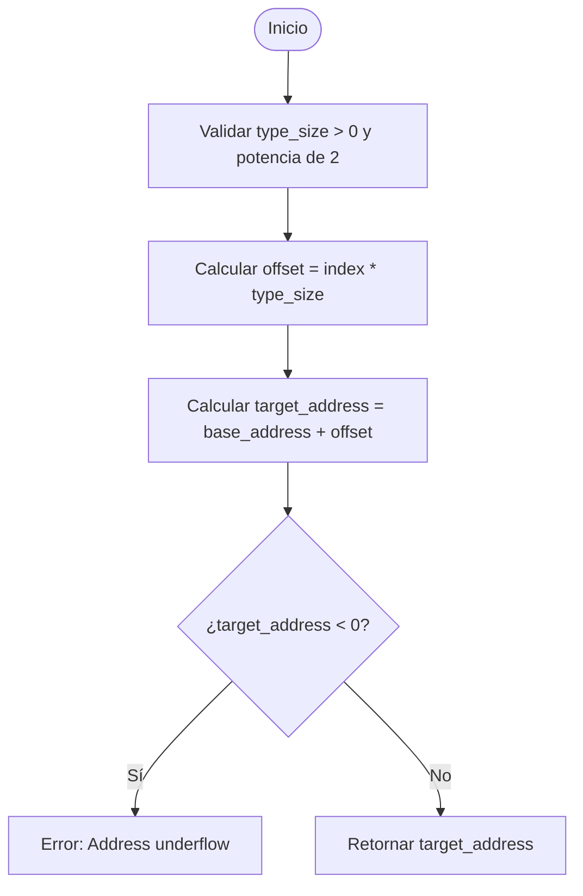

# Ejercicio 01: Cálculo de Desplazamiento y Aritmética de Punteros

<!-- metadata: {"notebook_id": "fase0-soc", "unit": "tramo5", "kc_id": "aritmetica_punteros", "exercise_type": "PROGRAMMING"} -->

## Enunciado
Implementar una función que calcule la dirección de memoria resultante de una operación de desplazamiento de puntero tipado, verificando la escala `sizeof(T)` y detectando accesos desalineados o desbordamiento fuera del bloque asignado.

## Contrato y Precondiciones
- **PRE**: `base_address` entero positivo representando dirección física base. `index` entero (desplazamiento). `type_size` tamaño en bytes del tipo de dato (ej: 4 para int32, 8 para int64/puntero).
- **POST**: Retorna la dirección resultante exacta `base + index * type_size`. Si el tamaño del tipo no es potencia de 2 o es menor a 1, lanza `ValueError`.

## Diagrama de Flujo (Mermaid)


## Pseudocódigo Estructurado
```text
ALGORITMO CalcularDireccionPuntero(base: Entero, indice: Entero, tam_tipo: Entero) -> Entero
INICIO
    SI tam_tipo <= 0 ENTONCES
        ERROR "Tamaño de tipo inválido"
    FIN SI
    
    desplazamiento <- indice * tam_tipo
    direccion_final <- base + desplazamiento
    
    RETORNAR direccion_final
FIN
```

## Código / Solución
```python
def calcular_direccion_puntero(base_address: int, index: int, type_size: int) -> int:
    if type_size not in (1, 2, 4, 8, 16):
        raise ValueError(f"type_size invalido: {type_size}. Debe ser potencia de dos (1, 2, 4, 8, 16).")
    if base_address < 0:
        raise ValueError("base_address no puede ser negativa.")
    
    offset = index * type_size
    target = base_address + offset
    if target < 0:
        raise ValueError("Direccion calculada resulta en underflow negativo.")
    return target
```

## Tests / Verificación
```python
# Array de int32_t (4 bytes) en base 0x1000 (4096)
assert calcular_direccion_puntero(4096, 0, 4) == 4096
assert calcular_direccion_puntero(4096, 1, 4) == 4100
assert calcular_direccion_puntero(4096, 3, 4) == 4108

# Array de int64_t / punteros (8 bytes) en base 0x2000
assert calcular_direccion_puntero(0x2000, 2, 8) == 0x2010

# Retroceso de puntero (p - 2)
assert calcular_direccion_puntero(4100, -1, 4) == 4096

try:
    calcular_direccion_puntero(1000, 1, 3)
    assert False, "Debio fallar con type_size invalido (3)"
except ValueError:
    pass
```

## Complejidad y Análisis
- **Big-O Temporal**: $O(1)$ operación aritmética directa en ciclos simples de ALU.
- **Big-O Espacial**: $O(1)$ memoria de registros de CPU.
