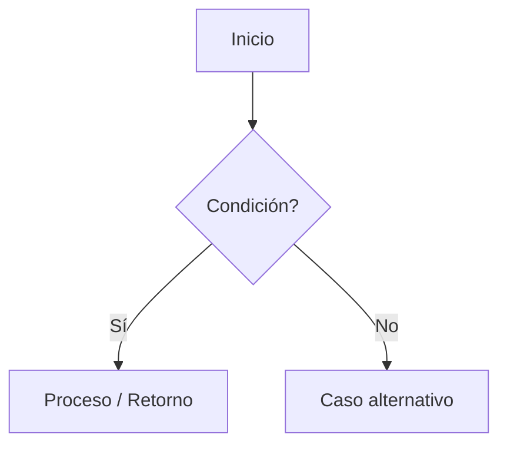

# Ejercicio: [nombre_del_ejercicio]

## Enunciado
[Descripción clara y concisa del problema a resolver]

## Contrato Formal
```
PRE: [Precondiciones sobre tipos, rangos y validez de los argumentos]
POST: [Postcondiciones sobre el valor de retorno o mutación de estado]
```

## Diagrama de Flujo


## Pseudocódigo
```
FUNCIÓN nombre_funcion(parametro)
    // Cláusula de guardia
    SI NO cumple_precondicion ENTONCES
        RETORNAR error_o_falso
    FIN SI

    // Lógica determinista
    RETORNAR resultado
FIN FUNCIÓN
```

## Código Python
```python
def nombre_funcion(parametro: int) -> bool:
    """Implementación limpia con Type Hints y Clean Code."""
    if parametro < 0:
        return False
    return True
```

## Tests
```python
assert nombre_funcion(10) == True
assert nombre_funcion(-1) == False
```
