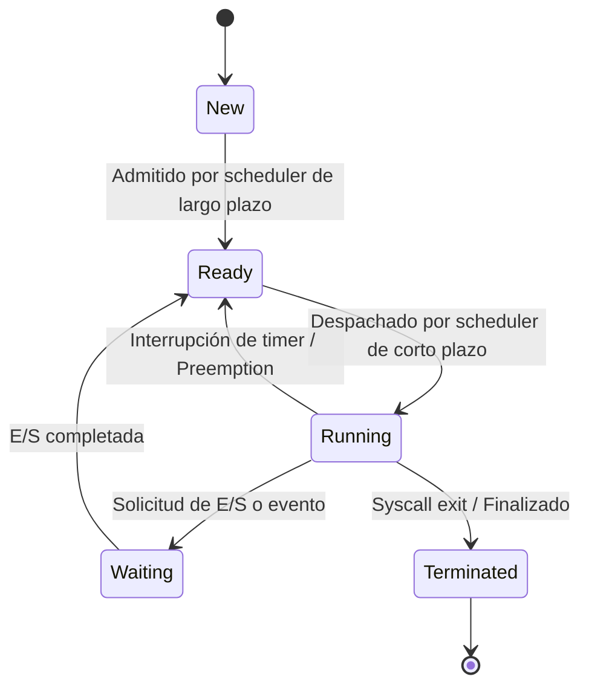

# Ejercicio: [nombre_del_ejercicio_so]

## Enunciado
[Descripción del problema de sistemas operativos: estados, scheduling, sincronización o deadlock]

## Diagrama de Estados


## Explicación de Transiciones

### New → Ready
El proceso es admitido por el planificador de largo plazo y se inicializa su PCB en la cola de listos.

### Ready → Running
El planificador de CPU despacha el proceso y la CPU ejecuta sus instrucciones.

### Running → Ready
El proceso consume su quantum de tiempo (interrupción de reloj) o es preemptado por un proceso de mayor prioridad.

### Running → Waiting
El proceso realiza una llamada al sistema bloqueante (lectura de disco, socket de red) y cede la CPU.

### Waiting → Ready
El hardware o subsistema de E/S emite una interrupción señalando que los datos están listos; el proceso retorna a la cola de listos.

### Running → Terminated
El proceso culmina su flujo de instrucciones normalmente o por señal anormal.

## Cálculos
```
// Tiempos de espera, turnaround time o matrices del Banquero
Proceso P1: Llegada=0, Ráfaga=4, Fin=4, Espera=0, Retorno=4
Proceso P2: Llegada=1, Ráfaga=3, Fin=7, Espera=3, Retorno=6
Tiempo Medio de Espera = (0 + 3) / 2 = 1.5
```

## Análisis Crítico
[Análisis riguroso de limitaciones del modelo, comportamiento en arquitecturas multinúcleo o mitigación de race conditions]
