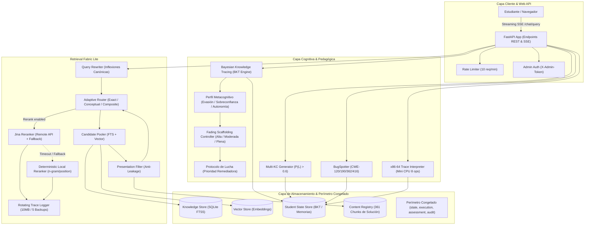

# Arquitectura del Sistema TALOS (v1.0-elite)

**Fecha**: 23 de Septiembre de 2026  
**Versión**: `v1.0-elite.1`  
**Estado**: Certificado y Congelado  

---

## 1. Visión General de la Arquitectura

TALOS es un tutor epistémico adaptativo construido bajo una arquitectura modular desacoplada en capas, diseñada para garantizar soberanía de datos, rigor formal, fail-closed por diseño y evaluación mediante código determinista.

### Diagrama de Componentes del Sistema

---

## 2. Descripción de Capas y Componentes

### 2.1 Capa de Interfaz y Transporte Web
- **FastAPI Core (`study_engine.web.app`)**:
  - Servidor asíncrono con streaming Server-Sent Events (SSE) en `/api/chat/query` para transmisión socrática en tiempo real.
  - Endpoints REST para administración, inspección y generación (`/fabric/status`, `/fabric/inspect`, `/api/exercises/generate`, `/api/student/metacognitive/profile`).
- **Control de Acceso y Rate Limiting (`study_engine.web.routes.retrieval`)**:
  - `InMemoryRateLimiter`: Aplica una ventana deslizante de 1 minuto limitando a 10 requests por IP para prevenir ataques de denegación de servicio o scraping en endpoints analíticos.
  - Verificación estricta de header `X-Admin-Token` con retorno `403 Forbidden` cuando se solicitan oráculos de corrección o inspección de pipeline.

### 2.2 Capa de Recuperación: Retrieval Fabric Lite
- **Query Rewriter Canónico (`QueryRewriter`)**:
  - Chokepoint de normalización que aplica expansiones e inflexiones canónicas validadas empíricamente (pila, grafo, hilo, nodo) evitando sobre-expansión o falsos positivos.
- **Router Adaptativo (`AdaptiveRouter`)**:
  - Clasificador determinista sin estado mutable que selecciona la estrategia óptima:
    - `EXACT_LEXICAL`: Para llamadas a API, tipos primitivos en C y registros de CPU.
    - `CONCEPTUAL_SEMANTIC`: Para principios y fundamentos teóricos.
    - `COMPOSITE_FACETED`: Para contrastes entre arquitecturas o paradigmas.
- **Presentation Filter (Anti-Leakage)**:
  - Intercepta el pool de candidatos antes del reranking y elimina automáticamente fragmentos clasificados como soluciones en el `ContentRegistry`.
- **Reranker de Dos Etapas con Fallback Gracioso**:
  - Etapa primaria (opcional): `JinaReranker` remoto (timeout $2.0$s con reintentos y jitter).
  - Etapa secundaria / local-first: `DeterministicLocalReranker` que combina cobertura ponderada de términos, bigramas contiguos y proximidad posicional con score acotado en $[0.0, 1.0]$.
- **Trazabilidad Forense (`get_retrieval_trace_logger`)**:
  - Emite eventos JSON enriquecidos (`RETRIEVAL_FABRIC_TRACE`) con métricas de latencia, perfil de ruteo y candidatos recuperados mediante un `RotatingFileHandler` (10 MB, 5 archivos de resguardo).

### 2.3 Capa Cognitiva y Pedagógica
- **Bayesian Knowledge Tracing (BKT)**:
  - Modela la probabilidad de maestría $P(L_t)$ por cada Knowledge Component (KC) mediante actualización bayesiana continua tras cada interacción o resolución de problema.
- **Perfil Metacognitivo y Fading Controller**:
  - Calcula en tiempo real las métricas de evasión, sobreconfianza y autonomía.
  - Ajusta el nivel de andamiaje (*Scaffolding*) en 3 fases: alta guía socrática, moderada con pistas, o plena autonomía con retiro de andamios.
  - Subordina el andamiaje a la precedencia del **Protocolo de Lucha (*Struggle Mode*)**, asegurando que un alumno frustrado reciba asistencia inmediata.
- **Generadores Dinámicos con Oráculos Deterministas**:
  - `MultiKCGenerator`: Compone desafíos cruzando KCs dominados ($P(L) > 0.6$) validados contra suites de tests estructurales en C.
  - `BugSpotter`: Inyecta mutaciones estáticas controladas en código C correspondientes a CWE-120, 190, 362 y 416.
  - `x86_interpreter`: Emula una CPU de 64 bits con memoria plana y control de pasos para generación determinista de tablas de traza de ejecución.

### 2.4 Capa de Almacenamiento y Seguridad Perimetral
- **Knowledge Store (`knowledge_store.db`)**:
  - Base de datos SQLite local con motor de búsqueda FTS5, almacenamiento de documentos, metadatos bibliográficos y jerarquías de carpetas/cuadernos.
- **Vector Store (`vector_store.db`)**:
  - Repositorio de embeddings vectoriales indexados para búsqueda semántica local.
- **Student State Store (`student_state.db`)**:
  - Almacena el historial longitudinal del estudiante, registros de intentos de ejercicios, estado BKT por KC y memorias pedagógicas a largo plazo (`Mem0Manager`).
- **Content Registry (`ContentRegistry`)**:
  - Catálogo criptográfico de 8.334 ítems y 361 identificadores de solución, garantizando que ninguna solución canónica sea legible por el alumno.
- **Perímetro Congelado**:
  - Los módulos `study_engine/{state,execution,assessment,audit}/` constituyen el núcleo crítico de invariantes de negocio y no se modifican bajo ninguna circunstancia operativa regular.

---

## 3. Invariantes de Seguridad del Sistema

1. **Invariante de Abstención Epistémica**:
   - Ante consultas cuyos términos no cuenten con suficiente cobertura en las fuentes canónicas del cuaderno activo, el sistema emite deterministamente un evento SSE `abstention` con código `QUERY_OUT_OF_SCOPE` (abstención determinista en protocolo). Jamás se genera una respuesta apócrifa o especulativa.
2. **Invariante de Aislamiento de Soluciones**:
   - Todo ejercicio generado o recuperado se presenta al estudiante sin las soluciones de referencia (`solution_text` = None). La inspección de soluciones requiere obligatoriamente privilegios de administración autenticados.
3. **Invariante de Perímetro Congelado**:
   - 0 líneas de diferencia en `src/study_engine/{state,execution,assessment,audit}/` respecto a la rama principal certificada.
4. **Invariante de Determinismo de Ruteo**:
   - 100 llamadas consecutivas al `AdaptiveRouter` con la misma entrada producen de manera idéntica el mismo perfil de ruteo y configuración de rerank.
5. **Invariante de Fallback de Reranker**:
   - Si el servicio externo opcional de Jina falla por timeout ($> 2.0$s), error de red o falta de API key, el sistema conmuta al `DeterministicLocalReranker` en menos de 5 ms sin arrojar excepciones no controladas.

---

## 4. Métricas de Calidad y Puertas de Certificación

| Métrica de Validación | Línea Base Requerida | Estado Final en v1.0-elite |
|---|---|---|
| **Suite de Tests Consolidada** | $\ge 2.400$ tests pasando | **2.441 passed, 7 skipped, 0 failed** (100% verde) |
| **Golden Set v1** | 18 / 18 PASS | **18 / 18 PASS (100% de aserciones)** |
| **Latencia p50 en Streaming** | $< 3.000$ ms | **505.4 ms** |
| **Latencia p90 en Streaming** | $< 6.000$ ms | **2541.2 ms** |
| **Precisión de Reranker Local** | Spearman $\ge 0.70$ | **$\rho \ge 0.70$ verificado en evaluación comparativa** |
| **Líneas Modificadas en Perímetro Congelado** | 0 líneas | **0 líneas (verificado con `git diff`)** |

> [!NOTE]
> **Incremento de Cobertura de Tests (Fase B $\to$ v1.0-elite)**: Al cierre de la Fase B, la suite contaba con 2.418 tests pasando. Durante la Fase 7 y la certificación final, se añadieron 23 tests automatizados (+14 tests de `RetrievalFabricLite`, `AdaptiveRouter` y `Reranker`, más suites unitarias de perfil metacognitivo y generación), consolidando la cifra definitiva de **2.441 tests pasando**.

---

## 5. Registro de Decisiones de Arquitectura (ADRs)

### ADR-1: Chokepoint Único de Retrieval en `retrieve_evidence` (Fase A)
- **Contexto**: Existían trayectorias de búsqueda divergentes (`search`, `search_hybrid`, `retrieve_evidence`) que podían omitir etapas de re-escritura o de filtrado anti-leakage.
- **Decisión**: Unificar el flujo en un único chokepoint que aplica secuencialmente: `QueryRewriter` $\to$ `AdaptiveRouter` $\to$ `CandidatePooler` $\to$ `PresentationFilter` $\to$ `Reranker`.

### ADR-2: Oráculos Deterministas Basados en Código (Fase B)
- **Contexto**: Evaluar la correctitud de código y mutaciones mediante juzgamiento por LLM introduce no-determinismo, costo y vulnerabilidad a alucinaciones.
- **Decisión**: Implementar suites de verificación estructural ejecutables en C/Python puro y un micro-intérprete x86-64 flat-memory con límite de pasos, garantizando validaciones formales e inmutables.

### ADR-3: Scaffolding Metacognitivo con Fading Desacoplado (Perfil Metacognitivo)
- **Contexto**: El andamiaje socrático debe adaptarse a la autonomía real del alumno sin interferir con las directivas curriculares ni descuidar situaciones de bloqueo cognitivo.
- **Decisión**: Formalizar las fórmulas de evasión y sobreconfianza basadas en ratios de solución, modularizar el nivel de fading en 3 categorías discretas y fijar precedencia absoluta para el Protocolo de Lucha (*Struggle Mode*).

### ADR-4: Arquitectura Híbrida de Reranking con Fallback Local (Fase 7)
- **Contexto**: Los rerankers neuronales remotos ofrecen excelente sensibilidad semántica pero introducen puntos únicos de fallo y latencia de red variable.
- **Decisión**: Integrar `JinaReranker` como acelerador opcional con timeout de $2.0$s y respaldarlo con `DeterministicLocalReranker` n-gram/posicional 100% offline, asegurando resiliencia total y operación local-first garantizada.

---

## 6. Proyección Arquitectónica: Roadmap v1.1

Para la próxima iteración mayor (**TALOS v1.1**), se proyectan las siguientes extensiones sobre la base arquitectónica consolidada:

1. **Context Engine 2.0**:
   - **Late Chunking**: Generación de embeddings a nivel de documento completo preservando las activaciones del transformer antes del corte de chunks, mitigando pérdidas de contexto en límites de párrafo.
   - **Multi-Vector ColBERT**: Búsqueda token-a-token para precisión fina en identificadores de código y directivas de preprocesador en C.
   - **Graph Retrieval Opcional**: Ontología de prerrequisitos de KCs navegable como grafo de conocimiento dirigido.
2. **Ampliación de Presupuesto de Contexto**:
   - Elevación del techo de $4.000$ a $5.000$ tokens para turnos multi-sesión extensos (resolución formal de BACKLOG-CTX-001).
3. **Benchmark Externo Reproducible**:
   - Batería de evaluación empírica a gran escala (300 a 500 consultas) comparando métricas de precisión y latencia contra soluciones comerciales en la nube.
