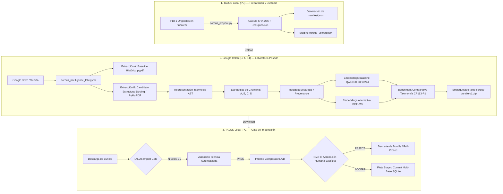

# 🏛️ Arquitectura del Corpus Intelligence Pipeline (TALOS Pre-V2)

**Estado:** Especificación de Arquitectura y Gobernanza Experimental  
**Versión:** 1.1 (CP114-PRE v4.1)  
**Alcance:** Pipeline Desacoplado de Preparación, Extracción, Vectorización e Importación de Corpus  
**Baseline de Producción:** READ-ONLY (`knowledge_store.db` / `vector_store.db` inmutables)  

---

## 1. Clasificación Tri-Partita de Decisiones del Pipeline

Para preservar la integridad epistemológica del proyecto, toda decisión o especificación del pipeline se clasifica formalmente en una de tres categorías ontológicas:

```text
┌────────────────────────────────────────────────────────────────────────┐
│               CLASIFICACIÓN TRI-PARTITA DE ESPECIFICACIONES            │
├──────────────────────────┬─────────────────────────┬───────────────────┤
│ A. INVARIANTES           │ B. BASELINE HISTÓRICO   │ C. HIPÓTESIS      │
│    (No Negociables)      │    (Punto de Comparación│    EXPERIMENTALES │
├──────────────────────────┼─────────────────────────┼───────────────────┤
│ • Identidad por SHA-256  │ • Extractor pypdf       │ • Extractor       │
│ • Production DB inmutable│ • Chunking 500 chars    │   Docling/PyMuPDF │
│ • student_state aislado  │ • Overlap 50 chars      │ • TableFormer v2  │
│ • Cero secretos a cloud  │ • Qwen3-Embedding-0.6B  │ • Chunks 1200-1500│
│ • Bundle con checksums   │ • Dimensión 1024d       │ • Chunks 800/2000 │
│ • Provenance obligatoria │ • max_length = 512      │ • Modelo BGE-M3   │
│ • bbox=null si no existe │ • Normalización L2      │ • Métricas y      │
│ • Fail-Closed en Import  │ • Mean pooling          │   thresholds      │
│ • Human Acceptance final │                         │ • Ganancia de     │
│ • Staged Multi-Base      │                         │   retrieval       │
└──────────────────────────┴─────────────────────────┴───────────────────┘
```

> [!IMPORTANT]
> - **Invariante:** Requisito de seguridad, soberanía o reproducibilidad. No cambia independientemente de los resultados del laboratorio.
> - **Baseline Histórico:** Lo que TALOS producía en V1. Debe reproducirse para contrastar objetivamente. Que sea baseline **NO** implica que sea el diseño futuro deseado.
> - **Hipótesis Experimental:** Propuesta técnica que debe ser medida en el laboratorio. **NO** es una decisión tomada y ningún valor se declara ganador antes del benchmark.

---

## 2. Diagrama de Flujo Extremo a Extremo



---

## 3. Especificación de Fases y Contratos de Interfaz

### Fase 1: Preparación Local de Corpus (`scripts/corpus_prepare.py`)
- **Objetivo:** Descubrir fuentes PDF, calcular hashes SHA-256 inmutables de 64 caracteres, detectar duplicados y construir el paquete canónico de subida sin alterar los archivos de origen.
- **Salida:** Directorio `corpus_upload/` con:
  - `manifest.json`: Inventario criptográfico descriptivo.
  - `pdf/`: Archivos PDF exclusivamente (bloqueo estricto de `.env`, `*.db`, logs o secretos).

### Fase 2: Procesamiento y Vectorización en Google Colab (`notebooks/corpus_intelligence_lab.ipynb`)
- **Objetivo:** Ejecutar la extracción experimental, segmentación comparativa, generación de metadatos de proveniencia y cálculo de embeddings densos.
- **Salida:** `talos-corpus-bundle-v1/` empaquetado en archivo `.zip` con sus sumas de verificación criptográfica (`checksums.sha256`).

### Fase 3: Evaluación y Aceptación en el Import Gate (`docs/CORPUS_IMPORT_GATE.md`)
- **Objetivo:** Inspeccionar de forma no destructiva el bundle recibido antes de autorizar cualquier mutación en las bases productivas.
- **Garantía:** Cero escrituras en producción sin validación técnica `PASS` y decisión humana `ACCEPT`.
- **Persistencia:** Aplicación mediante protocolo staged coordinado en dos fases (`VALIDATE -> STAGE -> PREPARE -> COMMIT/REPLACE -> VERIFY`).

---

## 4. Invariantes de Seguridad y Privacidad

1. **Aislamiento Absoluto de Datos de Usuario:**
   - Prohibición estricta de transferir a la nube:
     - `student_state.db` (progreso y datos del alumno).
     - `knowledge_store.db` o `vector_store.db` productivos.
     - Variables de entorno (`.env`), claves de API o credenciales.
     - Logs de auditoría, sesiones de chat o cachés locales.
2. **Contenido Exclusivo para la Nube:**
   - Únicamente viajan a la nube los PDFs seleccionados de cátedra y su `manifest.json`.
3. **Identidad Criptográfica de 64 Caracteres:**
   - La identidad canónica de cada documento en el bundle es su `document_id = "sha256:<64_hex_chars>"`.
4. **Provenance Transparente y Honesta:**
   - Si no se dispone de coordenadas espaciales precisas, se utiliza `bbox = null`. Queda estrictamente prohibido inventar bounding boxes.
