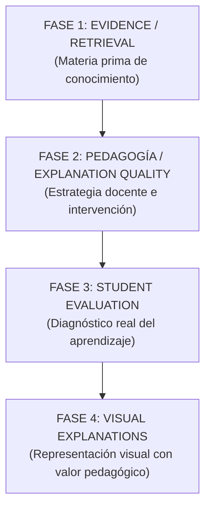
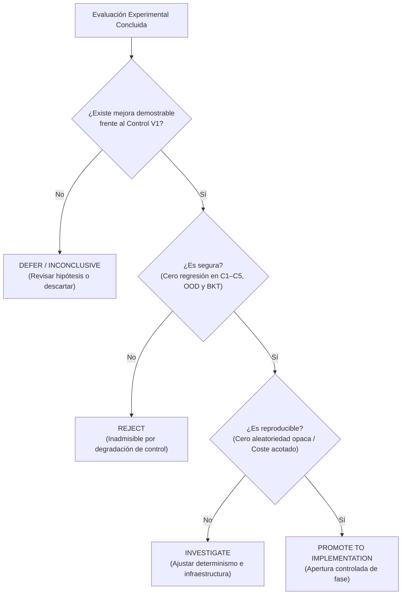

# TALOS V1.5 — MASTER ROADMAP
## Evidence → Pedagogy → Student Evaluation → Visual Explanations

**Documento Canónico de Arquitectura, Metodología y Hoja de Ruta V1.5**  
**Proyecto:** TALOS (Tutor Adaptativo de Lógica y Operaciones de Seguridad)  
- **Fecha de evidencia experimental:** 2026-10-05
- **Aclaración de precedencia documental:** 2026-10-07
- **Estado:** CANÓNICO PARA METODOLOGÍA Y EVIDENCIA EXPERIMENTAL; NO ES EL MAPA DE ESTADO OPERATIVO
- **Línea Base V1:** V1 CLOSED (Certificada en CP127 / `reports/V1_RELEASE_CERTIFICATION.md`)
- **Estado operativo vigente:** V1.5 `ACTIVE ROADMAP`; P1 `READY / NOT_STARTED`, según [`docs/PLAN_MAESTRO_CIERRE_TALOS.md`](PLAN_MAESTRO_CIERRE_TALOS.md)
- **Integridad de Producción:** último estado reportado al 2026-10-05: `DATABASE_CHANGES = 0` | `V1_RUNTIME_MODIFIED = FALSE`; no se revalida con esta aclaración documental.

---

## 0. Objetivo y Regla Fundamental

Este documento preserva la arquitectura, metodología, criterios experimentales
y evidencia de las líneas V1.5. El mapa operativo único para el estado actual
y la secuencia inmediata es
[`docs/PLAN_MAESTRO_CIERRE_TALOS.md`](PLAN_MAESTRO_CIERRE_TALOS.md).
Las etapas P0–P3 de ese mapa no son sinónimos de las fases metodológicas 1–4
descritas aquí.

Esta directiva **no constituye una autorización general para implementar**.
Fija dentro de su jurisdicción metodológica:
* Qué problemas aborda V1.5 y en qué secuencia estricta.
* Qué subproblemas y experimentos componen cada fase.
* Qué dependencias directas y cruzadas condicionan la evolución.
* Qué herramientas, modelos y técnicas deberán investigarse.
* Cómo se ejecutarán las comparaciones contra el baseline de control.
* Qué evidencia es indispensable antes de autorizar cualquier promoción.
* Qué invariantes de V1 se preservan intactas como control experimental.
* Qué hipótesis permanecen abiertas y cuáles quedan diferidas.

> [!IMPORTANT]
> ### Regla de Oro Metodológica de V1.5
> **V1 es el control. V1.5 no se incorpora por intuición, moda, disponibilidad de herramientas ni por una mejora anecdótica.**  
> Cada evolución debe demostrar beneficio medible frente al comportamiento V1 antes de ser promovida.  
> *"Primero demostrar que el problema existe, después demostrar que la solución mejora el baseline y solamente después modificar TALOS."*

---

## 1. Estado Base e Invariantes de Control V1

Con el cierre formal de V1 en CP127, se establece la distinción epistemológica fundamental:

```text
V1   = BASELINE / CONTROL CONGELADO
V1.5 = INVESTIGACIÓN + EXPERIMENTACIÓN + PROMOCIÓN SELECTIVA
```

La existencia de una capacidad pendiente, experimental o post-V1 no constituye deuda técnica ni defecto de V1. Toda investigación en V1.5 debe ejecutarse preservando estrictamente las siguientes invariantes como condiciones de control innegociables:

1. **Grounding Pedagógico:** Toda afirmación fáctica respaldada por citas `[E#]` válidas y verificables en el corpus canónico (C1).
2. **Autorización Multinivel de Fuentes:** Aislamiento de fuentes L3 y cumplimiento de roles autorizados; prohibición de fuga inter-documental (C2).
3. **Presupuesto Estricto de Contexto:** Respeto al techo normativo de 5.000 tokens y presupuesto efectivo de 4.761 tokens con poda determinista (C3).
4. **Aislamiento Curricular:** Partición rigurosa de espacios de conocimiento entre cuadernos independientes (C4).
5. **Abstención Confiable (Fail-Closed):** Activación determinista de abstención pre-LLM ante consultas fuera de dominio o evidencia insuficiente (C5).
6. **Protección Anti-Fuga:** Supresión de soluciones directas en fases socráticas y formativas.
7. **Memoria Soberana de Sesión:** Persistencia de estado multi-turno en SQLite local sin filtración a proveedores externos.
8. **Streaming SSE Resiliente:** Emisión estructurada de fases con tolerancia a fallos y cascada multi-proveedor.
9. **Evaluación Determinista de Código:** Oráculo offline reproducible sin dependencias estocásticas.
10. **Modelado Cognitivo del Estudiante:** Algoritmo BKT activo exclusivamente en puntos contractualmente autorizados (evaluación formal).
11. **Inmutabilidad de Almacenamiento Productivo:** Apertura de producción en `mode=ro` (`read_only=True`), directorios efímeros para tests y preservación byte-a-byte de bases SQLite.

No se degradará ninguna de estas propiedades de V1 para conseguir una mejora aislada en V1.5 sin un análisis explícito y formal de trade-offs.

---

## 2. Principio Central: Cuatro Capas Consecutivas

La evolución de TALOS sigue cuatro capas jerárquicas y unidireccionales:



La lógica operacional completa del ciclo de aprendizaje es:

```text
fuente primaria
  ↓
evidencia confiable (Fase 1)
  ↓
estrategia pedagógica (Fase 2)
  ↓
explicación / intervención (Fase 2 / Fase 4)
  ↓
respuesta del estudiante
  ↓
evaluación formativa / diagnóstica (Fase 3)
  ↓
actualización del estado pedagógico (BKT / SM-2)
  ↓
siguiente intervención curricular
```

**Regla de Secuencia:** La secuencia no debe invertirse. No se construirá una capa superior sobre un sustrato inferior que no haya demostrado solidez y estabilidad en su propio Promotion Gate.

---

## 3. Metodología de Investigación Transversal

Cada una de las cuatro fases seguirá rígidamente el ciclo de validación de diez etapas:

```text
1. ARQUEOLOGÍA OPERACIONAL
   Reconstrucción factual de lo existente, lo conectado y lo desconectado.
        ↓
2. DEFINICIÓN DEL PROBLEMA
   Formulación de la pregunta: ¿Qué problema intentamos resolver y qué evidencia demostrará que está resuelto?
        ↓
3. INVENTARIO DE HERRAMIENTAS Y TÉCNICAS
   Relevamiento objetivo de tecnologías candidatas aplicables.
        ↓
4. SELECCIÓN DE CANDIDATOS
   Definición de las 3 alternativas formales (A, B, C).
        ↓
5. DISEÑO DE BENCHMARK CANÓNICO
   Dataset de prueba, consultas representativas y métricas cuantitativas/cualitativas.
        ↓
6. EVALUACIÓN COMPARATIVA
   Ejecución controlada de los tres candidatos frente al control V1.
        ↓
7. ADJUDICACIÓN RIGUROSA
   Evaluación automatizada y juicio humano ciego con rúbricas unificadas.
        ↓
8. GATE DE DECISIÓN
   Dictamen objetivo: PROMOTE, DEFER, REJECT o INCONCLUSIVE.
        ↓
9. PLAN DE PROMOCIÓN E IMPLEMENTACIÓN CONTROLADA
   Diseño de ingeniería en entorno aislado con regresión completa.
        ↓
10. SINCRONIZACIÓN Y GOBERNANZA
   Emisión de checkpoint, reporte técnico e integración en baseline.
```

---

## 4. Regla de los Tres Candidatos (Three Cases Rule)

Para cada problema de ingeniería o investigación se evaluarán, obligatoriamente y en igualdad de condiciones, tres alternativas:

```text
┌────────────────────────────────────────────────────────────────────────┐
│ CANDIDATO A — MÁS PROMETEDOR                                           │
│ Opción con mayor potencial teórico o respaldo preliminar.               │
├────────────────────────────────────────────────────────────────────────┤
│ CANDIDATO B — ALTERNATIVA FUERTE                                       │
│ Solución sólida e independiente que compite directamente con A.        │
├────────────────────────────────────────────────────────────────────────┤
│ CANDIDATO C — BASELINE / CONSERVADOR                                   │
│ La alternativa más simple, estándar o equivalente al control V1.        │
└────────────────────────────────────────────────────────────────────────┘
```

**Criterio de Promoción:**
* Nunca se seleccionará A por el mero hecho de ser la opción novedosa o promocionada en la literatura.
* Si A y B no presentan una diferencia estadísticamente significativa o cualitativamente demostrable frente a C:
  ```text
  NO PROMOVER → REVISAR HIPÓTESIS → REDISEÑAR EXPERIMENTO
  ```
* Si la evidencia sigue siendo insuficiente o ambigua tras un segundo experimento, la decisión obligatoria es: `DEFERRED_POST_V1`.

---

## 5. FASE 1 — EVIDENCE RETRIEVAL

### 5.0 Propósito
Mejorar la calidad, precisión y completitud de la materia prima que alimenta a TALOS:
$$\text{PDF} \longrightarrow \text{Corpus} \longrightarrow \text{Representación} \longrightarrow \text{Embeddings} \longrightarrow \text{Retrieval} \longrightarrow \text{Evidencia}$$

No se busca recuperar "más texto". Se persigue:
* Mayor precisión semántica y relevancia estricta.
* Cobertura completa de conceptos sin fragmentación destructiva.
* Preservación de estructuras complejas (tablas, listas, código, diagramas).
* Trazabilidad y provenance material inmutable.
* Resiliencia a consultas OOD mediante fail-closed nativo.
* Presupuesto computacional acotado (CPU local y compatibilidad Colab).

Fase 1 comprende dos fronteras internas y una interfaz contractual:
* **Fase 1A:** `PDF → CORPUS` [COMPLETE — CP131]
* **Fase 1B:** `CORPUS → EVIDENCE` [COMPLETE / CANONICALLY CLOSED — CP137/CP139/CP140 | QREL_1B_FINAL CERTIFIED | RECONCILED]
* **Fase 1C:** `CORPUS ↔ RUNTIME BOUNDARY` [COMPLETE / CERTIFIED — CP142]
* **Fase 1D:** `EVIDENCE SELECTION & CALIBRATION` [ADJUDICATION RECONCILED / RESULTS CANONICAL / CLOSED — CP145-R1]
* **Fase 1E:** `PROMOTION GATE` [ADJUDICATED / CLOSED — CP146-R1 | PHASE_1_PROMOTABLE = FALSE | PROMOTION = NOT_AUTHORIZED | BASELINE C0 RETAINED]
* **Fase 1 Cierre Global:** `EVIDENCE / RETRIEVAL = CANONICALLY CLOSED` [CP147 | BASELINE C0 RETAINED | C4 DEFERRED | PHASE_2 BLOCKED]
* **Ingestion Intelligence Lab v2.0:** `PROBE-0 = EXECUTED & AUDITED` [CP148 | EXIT GATE PASSED | ADVANCE TO PROBE-1] | `PROBE-1 = CANONICALLY CLOSED` [CP149/CP150/CP151/CP152/CP153 | PROBE_1 = CLOSED | EXIT_GATE = FAIL | ROUTER_PRODUCTION = REJECTED | PARETO COST REDUCTION = 86.79% | PROBE-2 = NOT_STARTED (EXECUTION FORBIDDEN) | DATABASE_CHANGES = 0]

---

### 5A. FASE 1A — PDF → CORPUS (Ingestión y Representación)

```text
PDF Primario
    ↓
Extracción Multimodal / Estructural (1A.1)
    ↓
Árbol Jerárquico Documental (1A.2)
    ↓
Limpieza y Normalización
    ↓
Chunking Estructural y Especializado (1A.3)
    ↓
Enlace de Provenance Inmutable (1A.4)
    ↓
Generación de Embeddings Canónicos (1A.5)
    ↓
Bundle Versionado de Corpus (1A.6)
```

#### 1A.1 Extracción
Comparar experimentalmente sobre las 1.623 páginas canónicas del corpus:
* **Candidato A:** Docling (IBM Granite-based parser).
* **Candidato B:** PyMuPDF (fitz) con heurísticas estructurales.
* **Candidato C:** pypdf (baseline V1 / CP115).

**Métricas Obligatorias:**
* Recuento exacto de caracteres, palabras y páginas procesadas.
* Integridad de tablas: porcentaje de celdas preservadas vs fragmentadas.
* Preservación de bloques de código: retención de indentación y saltos de línea.
* Detección de encabezados (H1, H2, H3) y orden de lectura en documentos multi-columna.
* Filtrado de headers y footers recurrentes (ruido no semántico).
* Tiempo de extracción y consumo de memoria RAM por página.

#### 1A.2 Representación Estructural
Diseñar un modelo documental jerárquico que distinga formalmente:
$$\text{Nodo Estructural Documental} \neq \text{Unidad de Retrieval (Chunk)}$$
El modelo debe representar el árbol de contenido:
`Documento → Capítulo → Sección → Subsección → Párrafo | Tabla | Lista | Código | Figura`.

#### 1A.3 Chunking Especializado
Comparar sobre la base de los hallazgos de CP114–CP118:
* **Baseline C:** Chunking fijo por longitud de caracteres con overlap.
* **Candidato B:** Chunking estructural por límites de sección/encabezado.
* **Candidato A:** Chunking jerárquico Parent/Child con tipificación especializada para tablas markdown y bloques de código.

#### 1A.4 Provenance Material
Todo chunk producido debe satisfacer el contrato de procedencia:
* `document_id`: Identificador canónico del documento fuente.
* `source_id`: Identificador de la fuente curricular.
* `page_number`: Página física exacta en el PDF original.
* `structural_path`: Ruta jerárquica en el documento (ej. `Capítulo 3 > Sección 3.2`).
* `pipeline_version`: Hash o tag del pipeline extractor que lo produjo.
* `corpus_hash`: Hash SHA-256 del artefacto origen.

#### 1A.5 Modelos de Embedding
Evaluar en benchmark controlado bajo idénticas condiciones de pooling y normalización:
* **Candidato A:** Qwen3-Embedding (1024d, pooling lasttoken/mean).
* **Candidato B:** BGE-M3 o E5-multilingual.
* **Candidato C:** DeterministicHashEmbedder (baseline de test) / E5-small (384d).

**Contrato de Embedding Inmutable:**
Cada modelo debe registrar formalmente su contrato técnico:
```text
MODEL_ID
DIMENSIONS
MAX_TOKENS
POOLING_STRATEGY (lasttoken | mean | cls)
NORMALIZATION (L2)
QUERY_PREFIX / PASSAGE_PREFIX
LIBRARY_VERSION
```

#### 1A.6 Artefacto Versionado de Corpus (Bundle)
La salida de 1A no entra directamente a producción. Se empaqueta en un bundle sellado criptográficamente:
```text
corpus_bundle_<timestamp>.zip
├── manifest.json (metadatos, dimensiones, contratos, hashes)
├── documents.jsonl
├── chunks.jsonl
├── embeddings.blob (o SQLite vector DB)
└── extraction_report.json
```
Estados del artefacto: `EXPERIMENTAL → BENCHMARKED → CANDIDATE → AUTHORIZED → IMPORTED`.

---

### 5B. FASE 1B — CORPUS → EVIDENCE (Recuperación y Selección)

> [!IMPORTANT]
> **Estatus Canónico de Gobernanza de Fase 1B:**
> * `1B DESIGN = SEALED` (v1.0.2-canonical, SHA-256: `0f61adfbb5048982c77cab8388796319c8b8c99d1726f4fde9826ea992c9f426`)
> * `1B EXECUTION = COMPLETE` (Execution ID: `run_1b_canonical_20261005_151258`, Duración: 38.44s, Checkpoint 137)
> * `BLIND ADJUDICATION = COMPLETE` (N=1 Blind Human Specialist, 176 celdas, Checkpoint 139)
> * `QREL_1B_FINAL = VALID & CERTIFIED` (SHA-256: `497c7b37d8e01ad03d58dcb7694d9df616c243545ea48ed0ede270ecf7b583b3`)
> * `DESBLINDING = AUDITED & EXECUTED` (`HUMAN_ADJUDICATION_1B_UNMASKED.json`)
> * `FINAL METRICS = COMPUTED` (`FINAL_METRICS_1B.json`, SHA-256: `59dc7c9cf92a46f9abb84e29dfbe7b25213e322d154acd186758137a8fe1f44c`)
> * `CANONICAL RECONCILIATION = PASS` (Checkpoint 140, `reports/v1_5_phase1/CP140_PHASE_1B_CANONICAL_RECONCILIATION.md`)
> * `FASE 1B STATUS = COMPLETE / CANONICALLY CLOSED`
> * `PRODUCTION ISOLATION = CERTIFIED` (`DATABASE_CHANGES = 0`, `V1_RUNTIME_MODIFIED = FALSE`)

```text
Query del Estudiante
    ↓
Normalización / Routing Léxico
    ↓
┌───────────────────────┴───────────────────────┐
│                                               │
FTS5 BM25 (Control V1)              Dense Vector Search (Candidato)
│                                               │
└───────────────────────┬───────────────────────┘
                        ↓
            Fusión de Candidatos (RRF / Weighted)
                        ↓
               Pool Unificado de Candidatos
                        ↓
             Reranking Neuronal (Multilingüe)
                        ↓
           Selección / Expansión de Contexto
                        ↓
        Compuerta de Confianza C5 (Grounding / Trust)
                        ↓
              Evidencia Acreditada hacia LLM
```

#### 1B.1 Baseline FTS5
Se preserva FTS5 BM25 nativo SQLite como control absoluto de V1. Ninguna solución densa reemplazará a FTS5 sin demostrar superioridad en consultas exactas y terminología técnica.

#### 1B.2 Dense Retrieval
Evaluar la incorporación de recuperación densa en arquitecturas híbridas:
* $H_0$: FTS5 BM25 aislado (Control V1).
* $H_1$: FTS5 + Qwen3-Embedding (1024d).
* $H_2$: FTS5 + BGE-M3.

#### 1B.3 Fusión de Rankings
Comparar estrategias de combinación:
* Reciprocal Rank Fusion (RRF) con constante $k=60$.
* Fusión ponderada con normalización min-max.
* Candidate Pooling condicional según entropía de la consulta.

#### 1B.4 Reranking Multilingüe
Evaluar el impacto de un paso de reranking posterior a la fusión:
* **Candidato A:** Qwen3-Reranker.
* **Candidato B:** Jina Reranker v2 / BGE-Reranker-M3.
* **Candidato C:** DeterministicLocalReranker (Control V1).

**Variables a Medir:** nDCG@5, MRR, latencia p50/p95, consumo de memoria en inferencia y comportamiento ante fallas de red (fail-closed a local).

#### 1B.5 Selección de Contexto y Expansión Condicional
Retomar la evidencia empírica acumulada en CP119–CP122:
* **Hipótesis abierta:** La expansión contextual (hoja $\to$ sección) sólo es beneficiosa cuando el retrieval inicial posee alta precisión pero evidencia incompleta. En recuperaciones ruidosas, la expansión inyecta tokens distractores que degradan la atención del LLM y saturan C3.
* ContextPack y Sufficiency Gate permanecen como hipótesis de investigación diferidas, sujetas a la demostración de un mecanismo de activación de alta precisión.

#### 1B.6 Retrieval Fabric Reevaluado
Reevaluar de forma modular la pipeline histórica:
`QueryRewriter → AdaptiveRouter → CandidatePooler → PresentationFilter → Reranker`.
Ningún componente histórico se reincorporará por inercia; cada uno deberá justificar empíricamente su ganancia frente al costo de latencia y complejidad.

---

### 5C. FASE 1C — CORPUS ↔ RUNTIME BOUNDARY

> [!IMPORTANT]
> **Estatus Canónico de Gobernanza de Fase 1C:**
> * `1C STATUS = COMPLETE / CERTIFIED` (Checkpoint 142)
> * `1C SPECIFICATION = SEALED` (v1.0.0-canonical, SHA-256: `891215a69935f42c901e7121c1bfa092abc7b6199f5b9a02c5ec598a8cbf5ce3`)
> * `1C PREFLIGHT = PASSED` (14/14 Controles Verificados, SHA-256: `755cc69e4feded4931d929da4c3c1843ef1661e8656e3d17ed7d68a7169bc01c`)
> * `1C PROTOCOL SEAL = CERTIFIED` (Checkpoint 141, SHA-256: `bb9e4b797843b3e2157433177c1705207e9bd5c809f27779956cff03a42b7bf1`)
> * `1C EXECUTION MANIFEST = FROZEN` (`experiments/v1_5_phase1c/PHASE_1C_EXECUTION_MANIFEST.json`, SHA-256: `d2faa71eff0fca54a874ee1ea471e50b9e20ba900f96d6c3b64c98c403f65a02`)
> * `1C EXECUTION RUNNER = EXECUTED` (`experiments/v1_5_phase1c/execution/phase_1c_runner.py`, SHA-256: `89b2f38f8b2db57af4b0577ee597683a585d133063f7fdd4978357b6969d0ccb`)
> * `1C VERDICT = PASS` (Controles C0–C8: 9/9 PASS, Controles Negativos NC-01–NC-05: 5/5 PASS, 0 Defectos Críticos)
> * `1C BOUNDARY REPORT = CERTIFIED` (`reports/v1_5_phase1/PHASE_1C_CORPUS_RUNTIME_BOUNDARY_REPORT.md`, SHA-256: `3cf0f6a0e5f47a4f64bf9bac007e36562deba3ba7237a64f55bfe40b27d6fda2`)
> * `PRODUCTION ISOLATION = CERTIFIED` (`DATABASE_CHANGES = 0`, `V1_RUNTIME_MODIFIED = FALSE`)
> * `NEXT AUTHORIZED WORK = PHASE 1D SPECIFICATION`

Definir y auditar la interfaz estricta entre el proceso de construcción del corpus y el runtime del servidor TALOS:
* **Cadena de Identidad de 9 Eslabones:** `SOURCE → EXTRACTED DOCUMENT → CANONICAL CHUNK → HARMONIZED REPRESENTATION → EMBEDDING / INDEX ARTIFACT → RUNTIME STORE → RETRIEVAL HIT → CONTEXT PACK → CITATION / PROVENANCE`.
* **Controles Operacionales Preregistrados:** 9 controles obligatorios ($C_0 \dots C_8$) y 5 controles negativos fail-closed ($NC\text{-}01 \dots NC\text{-}05$).
* **Rúbrica de Reconciliación Textual:** Clasificación exhaustiva bajo `BYTE_IDENTICAL`, `DECLARED_NORMALIZATION`, `DECLARED_TRANSFORMATION`, `UNDECLARED_TRANSFORMATION` y `MISMATCH`.
* **Aislamiento de Producción:** Ejecución estrictamente confinada a fixtures en `experiments/v1_5_phase1c/fixtures/` e índices `:memory:`.

---

### 5D. FASE 1D — EVIDENCE SELECTION & CALIBRATION (RETRIEVAL BENCHMARK CANÓNICO)

> [!IMPORTANT]
> **Estatus Canónico de Gobernanza de Fase 1D:**
> * `1D STATUS = ADJUDICATION_RECONCILED / RESULTS_CANONICAL / FASE_1D_CLOSED` (Checkpoint 145-R1)
> * `1D SPECIFICATION = RECONCILED` (v1.0.1-reconciled, SHA-256: `3005833080e5797131f88b8dc34afba9fcba40281456174d662f389774e1ade1`)
> * `1D PREREGISTRATION = RESEALED` (v1.0.1-reconciled, SHA-256: `05e0de813f0066aa409e64ed5ab978cc5388d8546d167a20f16077ca00e6b301`)
> * `1D METHODOLOGY = RECONCILED` (v1.0.1-reconciled, SHA-256: `667f2d8313c41894b9244c0dfe181ad0fe59bd03b654f6381496747ddd4a2321`)
> * `1D PREFLIGHT = PASSED (16/16)` (SHA-256: `3ed8855fc5f4aca2d532871929abc39c31d00a6b8e2085421f7ec57df64a6e46`)
> * `1D PROTOCOL SEAL = RESEALED` (SHA-256: `d3c0020ed295c3b14d50ba51483b13a7befc10d2f61aa01418bb37cfa4017775`)
> * `1D RECONCILIATION REPORT = CANONICAL` (`reports/v1_5_phase1/CP143_R1_PHASE_1D_RECONCILIATION.md`, SHA-256: `20ba9ab065222a4f9b4923443d1ad10a19e40c01f50ecc22023ed541501c4f0e`)
> * `1D BENCHMARK REPORT = CANONICAL` (`reports/v1_5_phase1/PHASE_1D_RETRIEVAL_BENCHMARK_REPORT.md`, SHA-256: `c517e279e87dfb146aa74c98b3f853bd9283bab9671b6b92eaaafc9073236680`)
> * `1D ADJUDICATION REPORT = CANONICAL` (`reports/v1_5_phase1/CP145_PHASE_1D_ADJUDICATION_REPORT.md`, SHA-256: `306c6ec1f3790d0afe1f3e79d2c294188946573e94d07e117dd9c4425ab3acd9`)
> * `1D ADJUDICATION RECONCILIATION = CANONICAL` (`reports/v1_5_phase1/CP145_R1_PHASE_1D_ADJUDICATION_RECONCILIATION.md`, SHA-256: `6b8da34cc97b0ba78b89a9fd44df519650091daacf80c50ae758c0da99d9756a`)
> * `1D EXECUTION MANIFEST = EXECUTED & AUDITED` (`experiments/v1_5_phase1d/execution/PHASE_1D_BENCHMARK_EXECUTION_MANIFEST.json`, SHA-256: `f4a3fe9c670f38684c1e96d8fb43964724087edf67ce401a4cee57ef68a541bc`)
> * `1D CELLS EVALUATED = 176` (22 consultas × 8 condiciones evaluadas en 41.65s contra QREL_1D_BASELINE)
> * `1D NEGATIVE CONTROLS = 5/5 PASS` (NC-01 a NC-05 superados al 100%)
> * `1D RECONCILED HYPOTHESES = H1: NOT_SUPPORTED/INCONCLUSIVE (P@1=16.67%, b=3, p=0.1250), H2: INCONCLUSIVE/NOT_SUPPORTED (C5 vs C6, ΔS=0), H3: INCONCLUSIVE/NOT_SUPPORTED (nDCG@5 gana, MRR@5 empata), H4: SUPPORTED (τ*=0.40 en Dense Qwen C1), H5: NOT_SUPPORTED (C7 τ=0.35, FRR_ID=94.4%)`
> * `1D RESULTS = CANONICAL` (Cierre canónico formalizado en CP145-R1; Fase 1E y promoción bloqueadas)
> * `PRODUCTION ISOLATION = CERTIFIED` (`DATABASE_CHANGES = 0`, `V1_RUNTIME_MODIFIED = FALSE`, `PRODUCTION_SELECTION = NOT_PERFORMED`)
> * `ANTI-P-HACKING = SEALED` (Prohibición expresa de modificaciones post hoc de queries, qrels o thresholds)

Diseñar y versionar un conjunto canónico de consultas representativas del dominio de sistemas operativos y programación en C:

```text
Tipologías de Consulta Requeridas:
1. Definición conceptual puntual
2. Mecanismo interno / flujo causal
3. Procedimiento técnico paso a paso
4. Comparación doctrinal entre conceptos
5. Análisis de código / debugging
6. Interpretación de tablas o estructuras
7. Consultas con evidencia distribuida en múltiples páginas
8. Consultas ambiguas o sub-especificadas
9. Consultas Out-Of-Domain (OOD) sintéticas
10. Ataques adversariales de cruce de fuentes
```

**Métricas Primarias:** nDCG@5, MRR@5, Precision@1/3/5, Strict Top-1 Sufficiency ($S@1$), Context Sufficiency, Tasa de Abstención OOD ($= 100\%$), Tasa de Falso Rechazo In-Domain ($\le 10\%$).  
**Adjudicación:** Protocolo ciego N=1 con evaluadores humanos y rúbrica predefinida ($0 \dots 3$ relevancia, $0 \dots 2$ suficiencia).

---

### 5E. FASE 1E — PROMOTION GATE DE FASE 1

> [!IMPORTANT]
> **Estatus Canónico de Gobernanza de Fase 1 (Evidence / Retrieval):**
> * `FASE 1 STATUS = FULLY & CANONICALLY CLOSED` (Checkpoint 147)
> * `FASE 1 SYNTHESIS & CLOSURE REPORT = CANONICAL` (`reports/v1_5_phase1/PHASE_1_CANONICAL_SYNTHESIS_AND_CLOSURE.md`, SHA-256: `86479597735cbdee4149abce78d2b89c43639bb5ef567c06387f8c736b9d4e86`)
> * `1E PROMOTION GATE ASSESSMENT = CLOSED` (Checkpoint 146-R1, Report SHA-256: `c925b357ded23534a8f7123b6b7549edd940eb5873cc5751401cdc1f1b0d3843`)
> * `PHASE_1_PROMOTABLE = FALSE` (Ningún candidato cumplió simultáneamente los 7 criterios contractuales de promoción)
> * `PROMOTION = NOT_AUTHORIZED` (Sustitución de baseline no permitida en esta fase)
> * `CURRENT_BASELINE = C0 (FTS5 BM25) RETAINED IN PRODUCTION`
> * `DEFERRED RESEARCH LINE = C4 (FTS5 + Qwen RRF) [DEFERRED RESEARCH CANDIDATE]`
> * `CANDIDATE ADJUDICATIONS = C0: BASELINE RETAINED, C1: DEFER, C2: DEFER, C3: REJECT, C4: DEFER, C5: REJECT, C6: REJECT, C7: REJECT`
> * `PHASE_2 = BLOCKED / NOT_AUTHORIZED` (Regla de Secuencia: no se edifica sobre sustrato no promovido)
> * `PHASE_2.X = CANDIDATE / NOT_AUTHORIZED` (CP138)
> * `PRODUCTION ISOLATION = CERTIFIED` (`DATABASE_CHANGES = 0`, `V1_RUNTIME_MODIFIED = FALSE`, `PRODUCTION_SELECTION = NOT_PERFORMED`)

Una solución de retrieval solo se promoverá a producción si cumple simultáneamente:
1. Mejora estadísticamente demostrable de relevancia y suficiencia frente al control V1 (FTS5).
2. Cero degradación en la tasa de abstención OOD de la compuerta C5.
3. Preservación estricta del presupuesto de contexto C3 ($\le 4.761$ tokens efectivos).
4. Provenance 100% material y trazable.
5. Compatibilidad contractual absoluta con el runtime de TALOS.
6. Latencia p95 por debajo del umbral de servicio ($\le 150$ ms en retrieval local).
7. Reproducibilidad determinista de resultados.

Dictámenes posibles: `PROMOTE` | `DEFER` | `REJECT` | `INCONCLUSIVE`.

---

## 6. FASE 2 — PEDAGOGÍA / EXPLANATION QUALITY

### 6.0 Propósito
Optimizar la eficacia instruccional con la que TALOS guía al estudiante.
No se buscan explicaciones "más extensas" ni "más elocuentes". Se busca:
> **Intervenciones pedagógicas precisas, adaptadas al nivel de dominio real del estudiante y respaldadas por evidencia fáctica.**

---

### 6A. Arqueología Pedagógica
Auditar el estado real de los subsistemas formativos en el código actual:
* Modo socrático vs. modo directivo/explicativo.
* Generación y graduación de pistas (*hints*).
* Detección y corrección de conceptos erróneos (*misconceptions*).
* Integración real entre el diálogo y el estado BKT/SM-2.
* Clasificación operativa: `CONNECTED` | `PARTIALLY_CONNECTED` | `DISCONNECTED` | `POST_V1`.

---

### 6B. Modelo de Intervención Pedagógica

```text
Consulta / Respuesta del Estudiante
    ↓
Estado Cognitivo (Mastery BKT + Historial de Errores)
    ↓
Objetivo de Aprendizaje del Nodo Curricular Actual
    ↓
Evidencia Recuperada y Certificada por C5
    ↓
Selección de Estrategia Pedagógica (Directiva, Socrática, Refuerzo)
    ↓
Generación Estructurada de la Intervención
    ↓
Chequeo de Comprensión (Pregunta Formativa de Retorno)
```

---

### 6C. Taxonomía de Intervenciones
Evaluar experimentalmente la idoneidad de doce tipos de intervención:
1. Explicación conceptual fundamental.
2. Explicación causal de mecanismos.
3. Demostración procedimental paso a paso.
4. Comparación y contraste entre conceptos afines.
5. Analogía contextualizada al modelo mental.
6. Ejemplo paradigmático de código/sistema.
7. Contraejemplo revelador de límites.
8. Desactivación guiada de misconception.
9. Pista socrática incremental (L1: conceptual $\to$ L2: direccional $\to$ L3: revelación guiada).
10. Recapitulación y síntesis de cierre de turno.
11. Anclaje con conocimientos previos del currículo.
12. Calibración de dificultad según nivel de dominio.

---

### 6D. Adaptación al Estudiante sin Invención
El LLM **no inferirá libremente el estado cognitivo** del estudiante a partir del chat. Los parámetros de adaptación (nivel de dominio $P(L_k)$, errores previos, posición en el DAG curricular) se inyectarán de forma estructurada y determinista desde la capa de estado de TALOS.

---

### 6E. Herramientas y Modelos
Separar tajantemente tres capas operacionales:
* **Generation Tool:** Modelos de lenguaje autorizados y prompts estructurados.
* **Evaluation Tool:** Evaluadores deterministas y oráculos pedagógicos.
* **Orchestration Tool:** Máquinas de estado y controladores de sesión soberanos.

---

### 6F. Benchmark Pedagógico
Evaluar las intervenciones en un panel comparativo frente a V1 sobre ocho dimensiones:
1. **Correctitud Técnica:** ¿La explicación es conceptualmente impecable?
2. **Grounding:** ¿Toda afirmación se deriva de la evidencia recuperada?
3. **Claridad Expositiva:** ¿La formulación es comprensible para el nivel del estudiante?
4. **Profundidad Causal:** ¿Explica el porqué del funcionamiento del sistema?
5. **Adaptación Cognitiva:** ¿Se ajusta al nivel de dominio y conocimientos previos?
6. **Eficacia Pedagógica:** ¿Fomenta la comprensión activa en lugar de la memorización pasiva?
7. **No-Invención:** ¿Evita hechos o comportamientos no demostrables en el corpus?
8. **Accionabilidad:** ¿Indica con nitidez el siguiente paso mental o práctico?

---

### 6G. Promotion Gate de Fase 2
No se promoverá una estrategia pedagógica por simple preferencia estética o estilística. Deberá demostrar:
* Mayor retención o comprensión en evaluaciones posteriores.
* Respeto absoluto a C1–C5 y al pacto socrático (cero soluciones directas si el nodo está en aprendizaje).
* Preservación de latencia de streaming aceptable ($\le 1.5$ s al primer token).

---

### 6H. Subfase 2.X — Modelos de Decisión Estructurada (Candidatos: Laya, Jev, Especializados)

> [!IMPORTANT]
> **Estatus de Gobernanza:** `CANDIDATE / NOT AUTHORIZED`  
> **Directiva Formal:** [`reports/v1_5_phase2/STRUCTURED_DECISION_MODELS_CANDIDATE_DIRECTIVE.md`](../reports/v1_5_phase2/STRUCTURED_DECISION_MODELS_CANDIDATE_DIRECTIVE.md)  
> **Dependencias:** Fase 1E completada y promoción formalmente autorizada. No altera Fase 1B, 1C, 1D ni 1E.  
> **Aislamiento:** `DATABASE_CHANGES = 0`, `V1_RUNTIME_MODIFIED = FALSE`, `PRODUCTION_INTEGRATION = NOT_AUTHORIZED`.

Línea de investigación experimental dedicada a evaluar modelos pequeños especializados en clasificación, scoring o decisiones estructuradas como **componentes auxiliares de decisión**, bajo el principio fundacional:

> **El modelo de decisión no debe convertirse en una nueva fuente de conocimiento.**  
> **Deterministic code first. AI second.**

#### Arquitectura Objetivo
```text
CORPUS
   ↓
RETRIEVAL
   ↓
EVIDENCE / CONTEXTPACK
   ↓
STRUCTURED DECISION MODEL (Laya / Jev / Especializado)
   ↓
DETERMINISTIC POLICY / ROUTER
   ↓
LLM NARRATOR / PEDAGOGICAL ACTION
```

#### Tareas Candidatas Preregistradas
1. **T1 — Evidence Sufficiency:** Clasificación tripartita (`SUFFICIENT`, `PARTIALLY_SUFFICIENT`, `INSUFFICIENT`).
2. **T2 — Abstention Decision:** Detección de suficiencia distinguiendo `ID + insufficient` vs `OOD`.
3. **T3 — Clarification Routing:** Clasificación (`ANSWER`, `RETRIEVE_MORE`, `ASK_CLARIFICATION`, `ABSTAIN`).
4. **T4 — Pedagogical Routing:** Selección (`DIRECT_EXPLANATION`, `SOCRATIC_HINT`, `MICRO_EXERCISE`, `CLARIFICATION`, `ABSTENTION`).
5. **T5 — Rubric Scoring:** Evaluación contra rúbrica explícita y evidencia autorizada (cero invención).
6. **T6 — Evidence-to-Decision Consistency:** Robustez y estabilidad ante evidencia reordenada o con ruido.

#### Reglas Metodológicas Estrictas
* **Cero Integración Prematura:** Secuencia obligatoria: `CANDIDATE` $\to$ `TECHNICAL AUDIT` $\to$ `TASK DEFINITION` $\to$ `OFFLINE BENCHMARK` $\to$ `COMPARATIVE EVALUATION` $\to$ `PROMOTION DECISION`.
* **Baseline Determinista Primero:** Cada tarea debe contar previamente con una solución determinista de control.
* **Salida Estructurada y Validada:** Salida JSON estricta bajo schema, sin generación lingüística libre ni re-interpretación por LLM.
* **Separación de Roles:** Ningún modelo de decisión asumirá simultáneamente roles de conocimiento, generación o estado de aprendizaje (BKT/SM-2).

---

## 7. FASE 3 — STUDENT EVALUATION

### 7.0 Propósito
Desarrollar y validar mecanismos diagnósticos de alta fidelidad para responder con certeza:
$$\text{¿El estudiante realmente comprendió el concepto?}$$
Distinguir rigurosamente entre:
$$\text{Respuesta Correcta por Azar/Memorización} \neq \text{Comprensión Profunda} \neq \text{Comprensión Transferible}$$

---

### 7A. Auditoría de Evaluación Existente
Analizar y clasificar el estado operacional de:
* Endpoint `/api/practice/evaluate` y controladores asociados.
* Motor de grading determinista vs estocástico.
* Oráculo pedagógico offline y reglas de evaluación.
* Rutas de actualización de BKT y cálculo de maestría.
* Infraestructura de ejecución de laboratorios y sandboxes (S6 / LabGraderBridge).

---

### 7B. Tipos de Evaluación a Investigar
1. **Evocación Directa (Recall):** Recuperación de hechos y definiciones clave.
2. **Explicación Conceptual:** El estudiante explica el mecanismo con sus propias palabras.
3. **Discriminación Crítica:** Identificación de diferencias sutiles o afirmaciones falsas.
4. **Diagnóstico de Errores:** Detección de misconceptions arraigados.
5. **Evaluación de Código:** Análisis de programas C, manejo de punteros y memoria.
6. **Debugging Asistido:** Diagnóstico de causas raíz en fallos de ejecución sintéticos.
7. **Razonamiento Multietapa:** Resolución de problemas interconectados.
8. **Transferencia Lejana:** Aplicación de un concepto a un escenario no visto previamente.

---

### 7C. Métricas de Calidad de Evaluación
* Sensibilidad y especificidad diagnóstica frente a oráculo experto.
* Tasa de Falsos Positivos (acreditar conocimiento inexistente).
* Tasa de Falsos Negativos (rechazar respuestas correctas no convencionales).
* Robustez ante variaciones léxicas y estilo de redacción.
* Determinismo y reproducibilidad de las calificaciones.

---

### 7D. Relación Estricta Evaluación $\to$ Estado Cognitivo (BKT)

```text
Respuesta del Estudiante
    ↓
Evaluador Acreditado (Determinista / Rúbrica)
    ↓
Dictamen Calificado (CORRECT, PARTIAL, INCORRECT, MISCONCEPTION)
    ↓
Canal Contractual Formal de Actualización
    ↓
Actualización de Probabilidad de Maestría P(L_k) en BKT
    ↓
Transición Curricular (Bloqueo / Desbloqueo de Nodos en DAG)
```

**Regla de Seguridad Cognitiva:** El chat libre y las respuestas conversacionales ordinarias **nunca mutarán el BKT**. La actualización de maestría está reservada a evaluaciones formales contractualmente delimitadas.

---

### 7E. Promotion Gate de Fase 3
Solo se autorizará la promoción de nuevos evaluadores si:
1. Demuestran superioridad diagnóstica frente al baseline determinista de V1.
2. Reducen significativamente la tasa de falsos positivos y falsos negativos.
3. No introducen distorsiones ni gaming en el modelo BKT.
4. Operan con tiempo de respuesta predecible y costo nulo o acotado.

---

## 8. FASE 4 — VISUAL EXPLANATIONS

### 8.0 Propósito
Determinar rigurosamente en qué condiciones una representación visual supera a la explicación textual y diseñar el mecanismo declarativo para generarla.
> **Principio:** No se asume que *"visual = mejor"*. La visualización debe justificar su valor reduciendo la carga cognitiva o facilitando el razonamiento espacial/estructural.

---

### 8A. Casos Prioritarios de Aplicación
* Modelos de memoria en sistemas operativos (Stack, Heap, Segmentos de texto/datos).
* Tablas de páginas y traducción de direcciones virtuales a físicas.
* Diagramas de transición de estados de procesos (Running, Ready, Blocked, Zombie).
* Estructuras de datos dinámicas en C (punteros dobles, listas enlazadas, árboles).
* Flujos de ejecución concurrente, condiciones de carrera y sincronización.
* Arquitecturas de red y protocolos en capas.

---

### 8B. Especificación Declarativa Intermedia: `SceneSpec`
Para garantizar reproducibilidad, validación estática y desacoplamiento, la generación visual no emitirá directamente SVG o código React sin validar. Se investigará la especificación intermedia `SceneSpec`:

```text
LLM Pedagógico
    ↓
SceneSpec (JSON Declarativo: Nodos, Aristas, Estados, Anotaciones, Fases)
    ↓
Validador de Integridad Estructural y Pedagógica
    ↓
Motor de Renderizado Determinista (Mermaid / SVG / Canvas)
```

Ventajas de la arquitectura SceneSpec:
* Permite auditar y corregir la visualización antes de renderizarla.
* Independiza la intención pedagógica de la biblioteca visual de frontend.
* Evita vulnerabilidades de inyección de código o XSS en el cliente.

---

### 8C. Benchmark Visual: Comparación Controlada
El benchmark comparará siempre de forma controlada:
$$\text{Texto Aislado (Control V1)} \quad \text{vs.} \quad \text{Texto + Visualización (Candidato V1.5)}$$
**Métricas de Evaluación:**
* Precisión conceptual del diagrama frente a la evidencia documental.
* Tiempo necesario para que el estudiante comprenda el mecanismo.
* Retención del concepto en evaluaciones posteriores.
* Carga cognitiva subjetiva y tasa de errores en razonamiento visual.

---

### 8D. Promotion Gate de Fase 4
Una capacidad visual se promoverá únicamente para tipologías de conocimiento donde se demuestre beneficio pedagógico estadísticamente medible. Queda descartada la implementación de un motor visual genérico u ornamental sin propósito instruccional específico.

---

## 9. Matriz de Dependencias entre Fases

```text
┌────────────────────────────────────────────────────────┐
│ FASE 1: Evidence / Retrieval                           │
└───────────────────────────┬────────────────────────────┘
                            │ Evidencia sólida
┌───────────────────────────▼────────────────────────────┐
│ FASE 2: Pedagogía / Explanation Quality                │
└───────────────────────────┬────────────────────────────┘
                            │ Intervención validada
┌───────────────────────────▼────────────────────────────┐
│ FASE 3: Student Evaluation                             │
└───────────────────────────┬────────────────────────────┘
                            │ Necesidad diagnóstica demostrada
┌───────────────────────────▼────────────────────────────┐
│ FASE 4: Visual Explanations                            │
└────────────────────────────────────────────────────────┘
```

**Regla de Desacoplamiento vs. Implementación:**
* La exploración conceptual y arqueológica de una fase posterior puede iniciarse de forma preliminar mientras la fase anterior concluye su evaluación.
* **Prohibición de Implementación Dependiente:** Queda terminantemente prohibido implementar código productivo de Fase $N+1$ apoyado sobre decisiones técnicas o supuestos no promovidos formalmente en Fase $N$.
  - *No implementar pedagogía adaptativa avanzada sobre un pipeline de retrieval no validado.*
  - *No implementar evaluadores sobre estrategias pedagógicas no definidas.*
  - *No implementar generadores visuales antes de identificar la necesidad instruccional concreta.*

---

## 10. Master Experiment Matrix

Durante el ciclo V1.5 se registrarán todos los experimentos en una matriz canónica unificada:

| Exp ID | Fase | Problema Evaluado | Candidato A | Candidato B | Candidato C (Control) | Métrica Principal | Resultado | Decisión | Checkpoint / Reporte |
|---|:---:|---|---|---|---|---|:---:|:---:|:---:|
| `EXP-1A-01` | 1A | Extracción de tablas en Joyanes | Docling | PyMuPDF | pypdf (V1) | Cell Integrity % | PENDING | PENDING | — |
| `EXP-1A-02` | 1A | Chunking estructural vs fijo | Parent/Child | Por Sección | Fijo 500c (V1) | Fragmentación % | PENDING | PENDING | — |
| `EXP-1A-03` | 1A | Embeddings multilingües | Qwen3-1024d | BGE-M3 | Hash/E5-384d | nDCG@5 / Latencia | PENDING | PENDING | — |
| `EXP-1B-01` | 1B | Fusión Híbrida FTS5 + Dense | RRF k=60 | Weighted Fusion | FTS5 solo (V1) | Sufficient@5 | PENDING | PENDING | — |
| `EXP-1B-02` | 1B | Reranking neuronal local | Qwen3-Reranker | Jina-Reranker | Sin Reranker (V1) | MRR / p95 ms | PENDING | PENDING | — |
| `EXP-2A-01` | 2 | Hints socráticos graduados | 3-Level Hint | Direct Hint | Canned Hint (V1) | Understanding % | PENDING | PENDING | — |
| `EXP-3A-01` | 3 | Evaluación de programas en C | Reglas + Rúbrica | AST Analysis | Keyword Match (V1) | Falsos Positivos % | PENDING | PENDING | — |
| `EXP-4A-01` | 4 | Visualización de memoria C | SceneSpec + SVG | Mermaid directo | Texto solo (V1) | Retención 48h | PENDING | PENDING | — |

Cada ficha experimental adjuntará obligatoriamente:
* Hipótesis formal $H_0$ vs $H_1$.
* Dataset de consulta y fixtures aisladas en `tmp_path`.
* Parámetros de ejecución, seeds aleatorias y entorno de hardware.
* Adjudicación de métricas automatizadas y juicios humanos ciegos.
* Veredicto categórico y justificación técnica.

---

## 11. Estados Oficiales del Ciclo de Vida

Todo componente, técnica o propuesta en V1.5 transitará formalmente por los siguientes estados sin admitir ambigüedades:

```text
HYPOTHESIS       → Hipótesis teórica formulada sin validación empírica.
RESEARCH         → En investigación exploratoria y arqueología operacional.
EXPERIMENTAL     → En ejecución bajo fixture aislada en tmp_path.
BENCHMARKED      → Evaluado cuantitativamente en el benchmark canónico.
CANDIDATE        → Preseleccionado para evaluación en Promotion Gate.
INCONCLUSIVE     → Evidencia insuficiente para discernir superioridad; requiere rediseño.
REJECTED         → Refutado empíricamente o causante de regresiones en V1.
DEFERRED_POST_V1 → Válido teóricamente pero postergado fuera del alcance actual.
AUTHORIZED       → Aprobado formalmente por el Promotion Gate para implementación.
IMPLEMENTED      → Código desarrollado y verificado en suite de regresión aislada.
INTEGRATED       → Promovido e integrado definitivamente en la base canónica.
```

---

## 12. Master Decision Loop

Al concluir la evaluación de cualquier experimento o fase:



---

## 13. Secuencia metodológica de investigación V1.5

La siguiente secuencia ordena las líneas de investigación y sus gates de
promoción. **No reemplaza el orden operativo P0–P3 ni decide qué trabajo de
ingeniería es el siguiente.** Para el estado inmediato, consultar el mapa
maestro operativo enlazado en §0.

```text
PRIORIDAD 1: FASE 1 — EVIDENCE RETRIEVAL
             Optimización de la materia prima: PDF → Corpus → Embeddings → Retrieval Híbrido.
             (Base epistémica de todo el sistema).
                     ↓
PRIORIDAD 2: FASE 2 — PEDAGOGÍA / EXPLANATION QUALITY
             Eficacia instruccional y adaptación cognitiva.
             (Una buena evidencia requiere una intervención pedagógica sólida).
                     ↓
PRIORIDAD 3: FASE 3 — STUDENT EVALUATION
             Diagnóstico confiable del aprendizaje y actualización formal de BKT.
             (Certeza sobre la maestría real del estudiante).
                     ↓
PRIORIDAD 4: FASE 4 — VISUAL EXPLANATIONS
             Representación declarativa SceneSpec para conceptos complejos.
             (Valor pedagógico visual justificado empíricamente).
```

---

## 14. Mandato Final de No Implementación

> **Esta directiva establece la metodología, fronteras, contratos y criterios
> experimentales de TALOS V1.5; no es la fuente exclusiva del estado operativo
> actual.**
>
> **Este documento, por sí solo, no autoriza implementación, modificación del
> runtime de V1, cambios de bases productivas ni nuevos experimentos.** Una
> tarea concreta requiere scope, precondiciones, aislamiento y autorización
> propios, además de respetar la secuencia del mapa operativo vigente.

```text
V1.5 METHODOLOGY = PRESERVED
OPERATIONAL ROADMAP = docs/PLAN_MAESTRO_CIERRE_TALOS.md
P1 = READY / NOT_STARTED (as of 2026-10-07)
```
