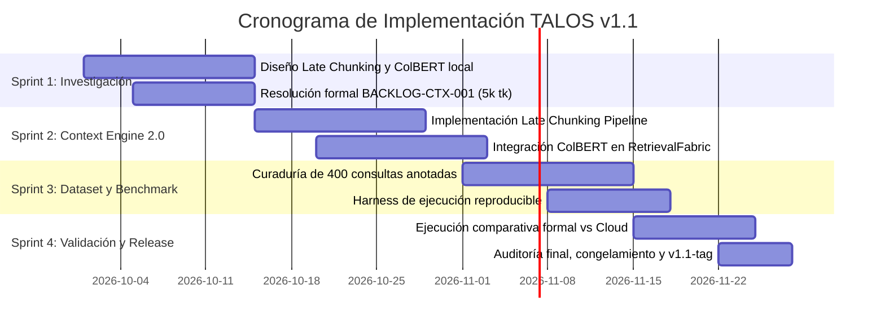

# Roadmap TALOS v1.1: Context Engine 2.0 y Benchmark Externo

**Versión de Proyecto**: TALOS v1.1  
**Línea Base**: v1.0-elite.1 (`commit 67fa4d3` + ajustes documentales)  
**Fecha de Planificación**: Septiembre 2026  
**Horizonte de Ejecución**: 8 semanas (4 Sprints)

---

## 1. Visión y Objetivos de la Versión 1.1

Tras la certificación de **TALOS v1.0-elite** (que consolidó la generación dinámica multi-KC, el micro-intérprete x86-64, el perfil metacognitivo adaptativo y el Retrieval Fabric Lite con 2.441 pruebas pasando), la versión **v1.1** se enfoca en resolver dos áreas estratégicas identificadas en la auditoría externa:

1. **Evolución del Motor de Recuperación (Context Engine 2.0)**: Superar las limitaciones de segmentación fija de texto mediante técnicas de embedding contextual tardío y granularidad multi-vector.
2. **Validación Científica a Gran Escala**: Reemplazar la evaluación cualitativa sobre 10 consultas por un **benchmark empírico reproducible de 300 a 500 consultas** comparado sistemáticamente contra arquitecturas en la nube (Gemini Notebook y Gemini Study Notebooks).
3. **Cierre Definitivo de BACKLOG-CTX-001**: Expandir el presupuesto de tokens a 5.000 tokens en coordinación con el frontend.

---

## 2. Pilares de Desarrollo

### Pilar 1: Context Engine 2.0

#### 1.1 Late Chunking (Embedding Contextual Continuo)
- **Problema actual**: El chunking tradicional fragmenta el texto antes del paso por el modelo de embedding, perdiendo dependencias sintácticas y anafóricas entre párrafos contiguos de manuales técnicos extensos.
- **Solución propuesta**:
  - Pasar secuencias completas de documentos (hasta 8.192 tokens) a través de un transformer encoder (p. ej., `jina-embeddings-v3` o equivalente open-weights).
  - Extraer las representaciones de los estados ocultos a nivel de token antes del pooling.
  - Aplicar pooling medio sobre los límites de cada fragmento sintáctico (*late chunking*), preservando la atención contextual global del documento en cada vector resultante.

#### 1.2 Multi-Vector Scoring (ColBERT / PLAID Local)
- **Problema actual**: Consultas con identificadores de código específicos (p. ej., nombres de structs en C, registros `%r8d`, flags de compilación `-fstack-protector`) sufren penalizaciones en embeddings bi-encoder densos globales.
- **Solución propuesta**:
  - Implementar un índice local multi-vector (ColBERT token-level late interaction) como etapa intermedia en el `RetrievalFabricLite`.
  - Mecanismo MaxSim determinista para calcular similitud máxima por término de consulta, optimizado para ejecución offline en CPU/GPU ligera.

#### 1.3 Graph Retrieval Curricular (Opcional / Experimental)
- Modelar el catálogo de Knowledge Components (KCs) y capítulos bibliográficos como un grafo dirigido de dependencias ($A \to B$ si $A$ es prerrequisito formal de $B$).
- Búsqueda híbrida que expande semillas de candidatos navegando ancestros inmediatos en el grafo curricular, enriqueciendo el contexto cuando el estudiante evidencia lagunas en conceptos previos.

#### 1.4 Resolución Definitiva de BACKLOG-CTX-001
- Ampliar el límite configurado de contexto de $4.000$ a **$5.000$ tokens** (+28% de margen sobre el $p99 = 3.688$ tokens observado empíricamente).
- Calibrar la compresión de directivas con la interfaz de usuario para garantizar cero truncamientos en sesiones pedagógicas multi-turno extensas.

---

### Pilar 2: Benchmark Externo Reproducible (300–500 Queries)

Para establecer comparaciones objetivas y reproducibles frente a Gemini Notebook y Gemini Study Notebooks, se diseñará un protocolo estandarizado de evaluación:

#### 2.1 Estructura del Dataset de Evaluación
El dataset contendrá 400 consultas anotadas con *ground truth* a nivel de fragmento y veredicto epistémico esperado:

| Categoría de Consulta | Cantidad | Objetivo de Prueba | Veredicto Esperado |
|---|:---:|---|---|
| **Conceptos Fundamentales de SO / C** | 120 | Cobertura conceptual, definiciones teóricas y memoria virtual. | Grounded + Citas exactas |
| **Símbolos y Sintaxis Estricta de Código** | 80 | Syscalls, funciones POSIX, llamadas al sistema, directivas de preprocesador. | Exact Lexical Match |
| **Comparativas Multi-Capítulo** | 80 | Contrastes entre arquitecturas (RISC vs CISC, Stack vs Heap, Hilos vs Procesos). | Composite Faceted Rerank |
| **Desafíos con Errores Sutiles (Bugs)** | 60 | Detección de vulnerabilidades (CWE-120, 190, 362, 416) y código erróneo. | Verificación estructural con oráculo |
| **Consultas Fuera de Dominio (OOD)** | 60 | Historia, cultura pop, ciencias no afines, bibliografía inexistente. | Abstención formal inmediata (100%) |
| **Total de Consultas** | **400** | Batería integral de evaluación curricular | — |

#### 2.2 Métricas de Rendimiento y Comparación
- **Rigor de Recuperación**: Mean Reciprocal Rank (MRR@5), Normalized Discounted Cumulative Gain (nDCG@5), Precision@3.
- **Rigor Epistémico**: Tasa de abstención correcta en OOD ($> 98\%$), tasa de falsa abstención en consultas curriculares ($< 2\%$).
- **Latencia y Costo**: Latencia p50/p90/p99 por consulta, huella de memoria RAM, requerimiento de conexión externa vs local.
- **Aislamiento Anti-Leakage**: 100% de retención de soluciones en enunciados de práctica evaluados.

---

## 3. Criterios de Aceptación y Puertas de Calidad (v1.1)

| Criterio | Métrica / Verificación Requerida | Estado Objetivo |
|---|---|:---:|
| **Invarianza del Perímetro Congelado** | `src/study_engine/{state,execution,assessment,audit}/` = 0 líneas diff | Mandatorio |
| **No Regresión en Pruebas** | Suite de pruebas automatizadas $\ge 2.441$ tests pasando, 0 fallas | Mandatorio |
| **Precisión de Retrieval (MRR@5)** | $\text{MRR} \ge 0.85$ en el benchmark de 400 consultas | Objetivo técnico |
| **Abstención en Consultas OOD** | $\ge 98\%$ de precisión fail-closed ante temas no curriculares | Mandatorio |
| **Latencia de Streaming** | $p50 < 2.500$ ms, $p90 < 5.000$ ms en streaming SSE | Mandatorio |
| **Operación Local-First** | 100% de la funcionalidad disponible sin dependencia de Internet | Mandatorio |

---

## 4. Cronograma Estimado de Ejecución

---

## 5. Gobernanza y Filosofía de Evolución

Cualquier cambio introducido durante el ciclo v1.1 deberá someterse a las siguientes tres reglas inmutables:
1. **Prioridad Epistémica sobre Fluidez**: Ninguna optimización de lenguaje natural o de estilo conversacional puede reducir el rigor de abstención ni tolerar afirmaciones no respaldadas por citas canónicas.
2. **Oráculos Ejecutables sobre Juicio Probabilístico**: La corrección de código y ejercicios debe validarse siempre mediante compiladores, suites de pruebas o emuladores deterministas.
3. **Soberanía del Estudiante**: Las estructuras de datos del estado del alumno, historiales de intentos y matrices BKT deben permanecer legibles y exportables en formatos abiertos (SQLite, JSON), garantizando independencia total respecto a plataformas propietarias.
